<div align="center">

# AURA

### Autonomous Unified Research Assistant for Battery Materials Discovery

*Two cooperating loops: a knowledge loop that harvests and structures the battery literature, and a discovery loop that evolves new cathode compositions against it.*

<br/>


<br/>

[Overview](#overview) ·
[Architecture](#architecture) ·
[Agents](#agents) ·
[Literature ingestion](#literature-ingestion) ·
[API keys](#api-keys-and-credentials) ·
[Quick start](#quick-start) ·
[API](#api-reference) ·
[Configuration](#configuration-reference) ·
[Troubleshooting](#troubleshooting)

</div>

---

## Table of contents

1. [Overview](#overview)
2. [Technology stack](#technology-stack)
3. [Architecture](#architecture)
4. [Agents](#agents)
5. [Literature ingestion](#literature-ingestion)
6. [API keys and credentials](#api-keys-and-credentials)
7. [Genetic algorithm](#genetic-algorithm)
8. [GraphRAG](#graphrag)
9. [LLM layer, quota and caching](#llm-layer-quota-and-caching)
10. [Data layer](#data-layer)
11. [Frontend](#frontend)
12. [Security](#security)
13. [Quick start](#quick-start)
14. [API reference](#api-reference)
15. [Configuration reference](#configuration-reference)
16. [Testing and verification](#testing-and-verification)
17. [Production deployment](#production-deployment)
18. [Project structure](#project-structure)
19. [Troubleshooting](#troubleshooting)
20. [Known limitations](#known-limitations)
21. [Documentation, contributing and license](#documentation-contributing-and-license)

---

## Overview

AURA helps researchers search for new battery cathode materials. You describe a target in plain language, for example *"a cobalt-free cathode above 250 mAh/g and under $50/kg"*, and AURA evolves real compositions toward it. It does this with two loops that share one knowledge base.

| Loop | Purpose | Runs |
|---|---|---|
| **Knowledge loop** | Harvest papers and encyclopedia entries, filter and de-duplicate them, embed them, and mine them into a chemistry knowledge graph | On demand from the Evidence tab, or nightly if enabled |
| **Discovery loop** | Plan, mutate, validate, predict and report on candidate materials over many generations | On every discovery request |

The knowledge loop feeds the discovery loop: harvested literature and mined graph facts are what the validator and predictor retrieve as evidence.

> **Core principle.** Chemistry decides what is allowed. The genetic algorithm and GraphRAG define the search space and the rules. The LLM only estimates properties inside that space, and it never invents compositions or chemistry rules.

### What you get

- **Natural-language planning** into numeric targets, material class and excluded elements.
- **Constraint-safe evolution** with elitism, tournament selection and canonical formulas.
- **Hybrid retrieval** from a Neo4j rule graph and pgvector literature (Supabase), fetched concurrently.
- **An automated paper-fetching pipeline** over arXiv, Crossref, PubMed and Wikipedia, with relevance filtering, de-duplication and a quota-aware graph miner.
- **Quota-aware LLM use.** A full run costs about 42 requests, and a spent quota fails the run with a clear message.
- **A results dashboard** with an executive summary, material cards, an evolution chart, an interactive knowledge graph and PDF export.
- **A chat that answers or discovers.** Ask mode answers questions from your harvested papers and the knowledge graph, with cited sources. Discover mode runs the evolutionary search.
- **Per-user history** in Supabase under row level security.

---

## Technology stack

<div align="center">

**Frontend**


**Backend and orchestration**


**Data and infrastructure**


**AI**


**Literature sources**


</div>

| Layer | Technology | Role |
|---|---|---|
| UI | React 19, Vite 8, TypeScript (strict), Tailwind CSS v4 | Single-page app, build tooling, styling |
| UI state | Zustand, React Context, React Hook Form, Zod | Research state, auth session, validated forms |
| Visualization and export | Recharts, `react-force-graph-2d`, Framer Motion, Lenis, `jspdf`, `html2canvas` | Charts, knowledge graph, motion, PDF report |
| API | FastAPI, Uvicorn, Pydantic v2 | REST endpoints and validation |
| Orchestration | LangGraph | The planner, mutator, predictor and reporter state machine |
| Async execution | Celery with Upstash Redis over TLS | Discovery runs, harvests, graph mining, optional nightly sweep |
| Package management | uv with `pyproject.toml` and `uv.lock` | Reproducible Python environment |
| Identity and relational data | Supabase (Auth and PostgreSQL) | JWT auth, `ResearchTasks`, `SavedMaterials`, `chat_messages`, `literature_chunks` (pgvector) |
| Knowledge graph | Neo4j (Aura or local) | Structural chemistry rules |
| Vector store | pgvector in Supabase Postgres, HNSW cosine index | Literature chunks and embeddings, in the same project as auth and run history |
| Embeddings | fastembed, local ONNX `all-MiniLM-L6-v2` (384-dim) | Offline semantic embeddings, no external call |
| LLM | OpenRouter free router, Gemini 2.5 Flash fallback | Planning, validation, prediction, summaries, triplet extraction |
| Harvesting | `httpx`, `defusedxml`, PyMuPDF, `langchain-text-splitters` | Source APIs, safe XML parsing, PDF parsing, chunking |
| Resilience | `tenacity` | Retry with exponential backoff |

---

## Architecture

### System context

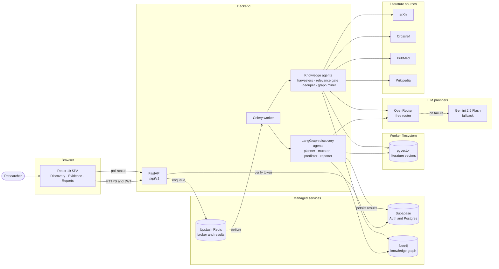

### The two loops

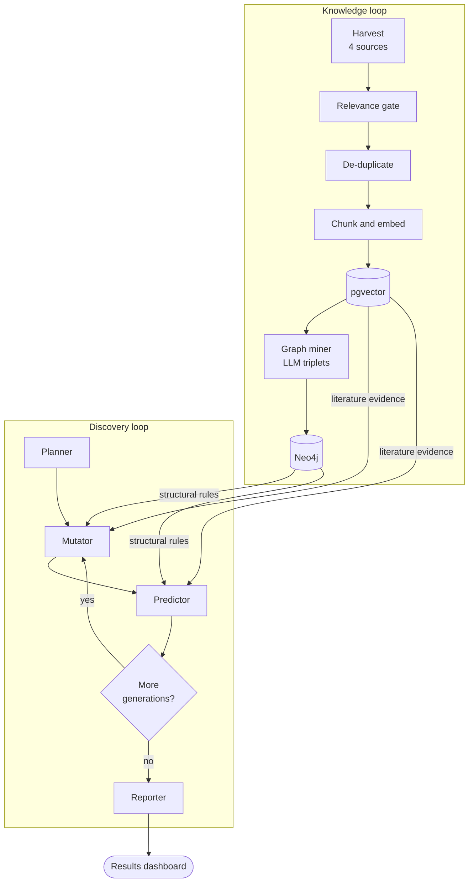

### Runtime topology

Three local processes plus an optional fourth, talking to managed services. No Docker is required.

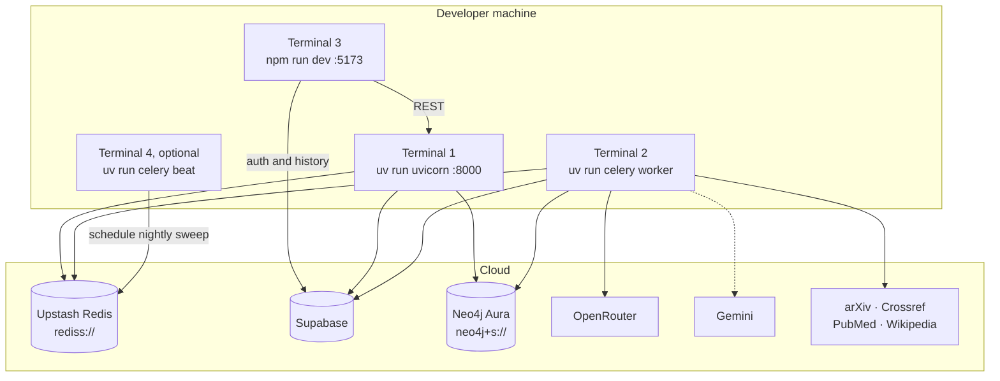

### Discovery request lifecycle

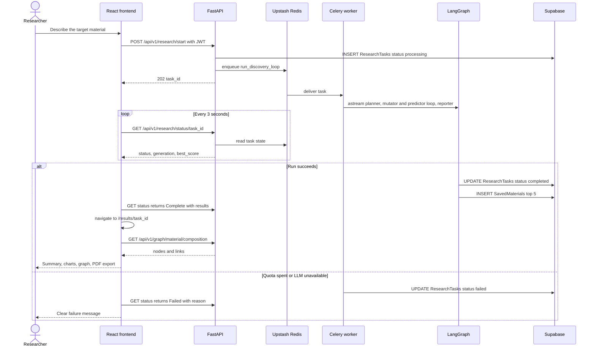

### Task state mapping

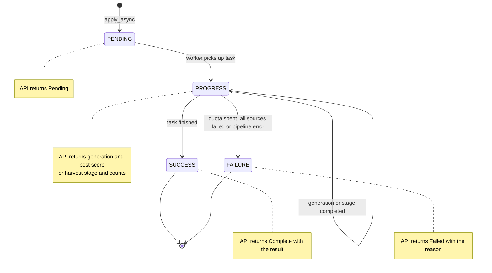

---

## Agents

AURA has two groups of agents. The **discovery agents** are LangGraph nodes that share one state object. The **knowledge agents** are Celery tasks and service modules that build the knowledge base the discovery agents read.

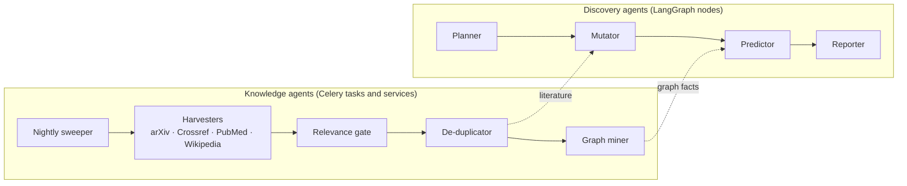

| Agent | Module | LLM calls | Role |
|---|---|---|---|
| **Planner** | `app/agents/nodes/planner.py` | 1 per run | Turns the prompt into targets and seeds the population |
| **Mutator** | `app/agents/nodes/mutator.py` | 1 per generation | Evolves candidates and validates them |
| **Predictor** | `app/agents/nodes/predictor.py` | 1 per generation | Predicts properties and scores fitness |
| **Reporter** | `app/agents/nodes/reporter.py` | 1 per run | Writes the summary and persists results |
| **arXiv harvester** | `app/services/harvesters/arxiv.py` | none | Fetches recent preprints |
| **Crossref harvester** | `app/services/harvesters/crossref.py` | none | Fetches journal articles with abstracts |
| **PubMed harvester** | `app/services/harvesters/pubmed.py` | none | Fetches biomedical and materials abstracts |
| **Wikipedia harvester** | `app/services/harvesters/wikipedia.py` | none | Fetches encyclopedia summaries |
| **Relevance gate** | `app/services/harvesters/relevance.py` | none | Drops off-topic documents |
| **De-duplicator** | `app/services/harvesters/deduplicator.py` | none | Skips documents already indexed |
| **Graph miner** | `app/services/graph/extractor.py`, `worker/tasks.py` | up to 10 per run | Extracts knowledge-graph triplets from chunks |
| **Nightly sweeper** | `worker/tasks.py` | via the graph miner | Harvests a fixed topic list on a schedule |

### Discovery agents

The agents are wired in `app/agents/workflow.py` over the shared `ResearchState` in `app/agents/state.py`.

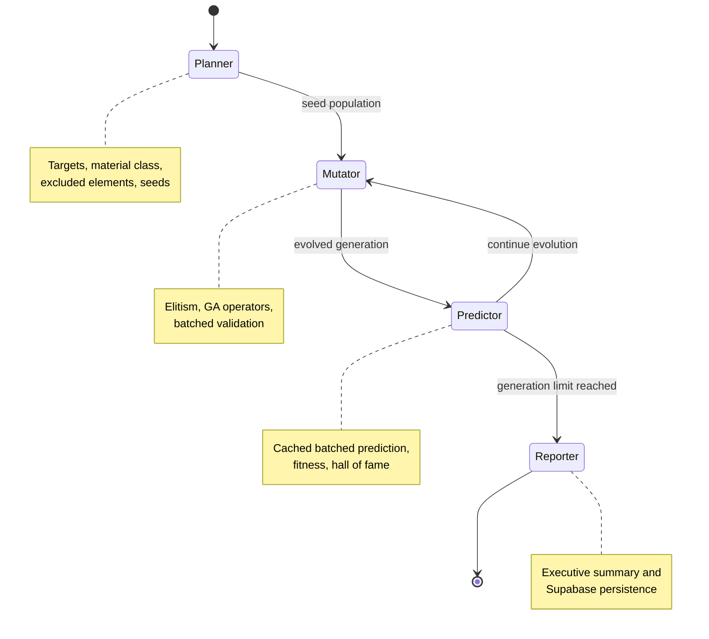

#### Planner

Parses the user prompt into constraints the rest of the pipeline can use.

| | |
|---|---|
| **Input** | The free-text prompt |
| **Output** | `target_properties` (for example `capacity_gt`, `cost_lt`, `voltage_gt`), `base_material_class`, `excluded_elements`, a seeded population and `max_generations` |
| **Seeds** | Six baseline layered oxides (NMC111, NMC532, NMC622, NMC811 and two cobalt-free variants), cycled to `GA_SEED_POPULATION`, skipping any with an excluded element |
| **LLM** | OpenRouter, then Gemini. One request |
| **Failure** | If both providers fail for an ordinary reason, the run continues with empty constraints. If the OpenRouter daily quota is spent and Gemini also fails, the run fails with a quota message |

#### Mutator

Produces each new generation and filters it for chemical validity.

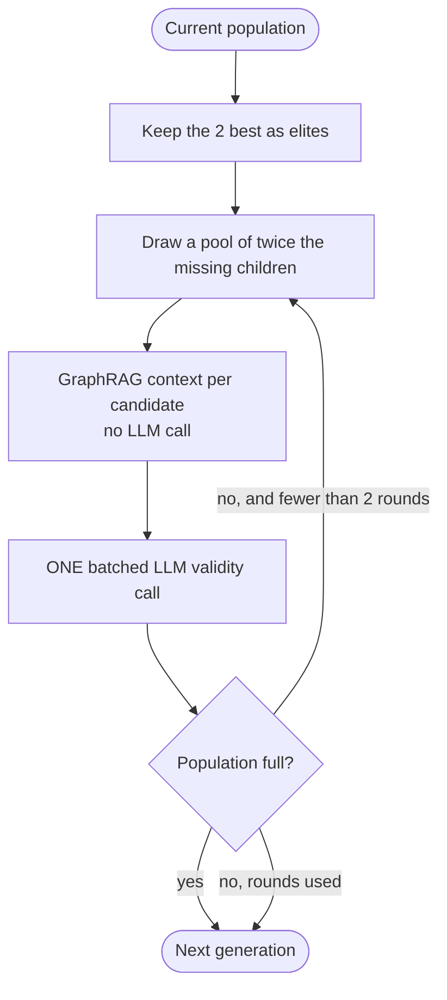

- Operators: doping 40%, substitution 40%, crossover 20%, with tournament selection of size 3. See [Genetic algorithm](#genetic-algorithm).
- Validity verdicts are cached by composition. A validation error accepts the pool unverified so a flaky LLM cannot stall evolution, but a quota error stops the run.

#### Predictor

Estimates capacity, voltage, cycle life and cost, then scores fitness.

- Compositions already predicted are served from a bounded, expiring cache.
- The rest go to the LLM in **one batched request**, each with its retrieved context (capped per item). Results come back by index, so a material cannot be dropped or renamed.
- A material the model omits is retried once; if it is still missing, the run fails instead of scoring it as zero.
- It keeps the top-5 hall of fame and a per-generation `best_score` and `average_score` history for the evolution chart.

#### Reporter

Closes the run.

- Writes a three-paragraph executive summary of the top candidates. If the LLM fails it uses a plain fallback text and still completes.
- Updates the `ResearchTasks` row to `completed` with the full result, and inserts the top five into `SavedMaterials`.

### Knowledge agents

These are described in detail in [Literature ingestion](#literature-ingestion).

---

## Literature ingestion

The knowledge loop is what makes the evidence base grow. It fetches **titles and abstracts or summaries**, not full-text PDFs, from four public sources, and turns them into searchable vectors and graph facts.

### Sources

| Source | Content fetched | API | Key | Rate handling |
|---|---|---|---|---|
| **arXiv** | Recent preprints: title, abstract, authors, date | Atom API at `export.arxiv.org`, sorted by submission date, scoped to materials-science categories | None | Throttled to arXiv's one request per three seconds |
| **Crossref** | Journal articles with abstracts, JATS tags stripped | REST `api.crossref.org/works`, filtered to records with an abstract | None. A contact email joins Crossref's polite pool | 0.2 s between calls |
| **PubMed** | Abstracts, with chemical formulas preserved | NCBI E-utilities `esearch` then `efetch` | Optional `NCBI_API_KEY` | 0.35 s between calls, 0.1 s with a key (3 to 10 requests per second) |
| **Wikipedia** | Page summary extracts | MediaWiki search plus the REST page-summary endpoint | None | 0.1 s between calls |

Each document gets a source-prefixed identifier: `arxiv:<id>`, `doi:<doi>`, `pubmed:<pmid>` or `wikipedia:<pageid>`.

### Pipeline

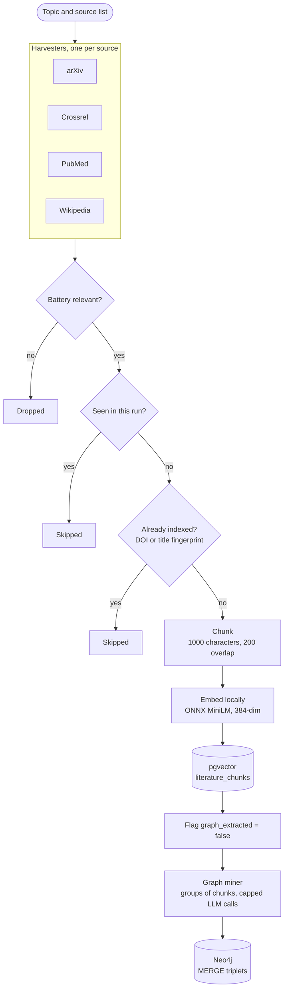

### End-to-end sequence

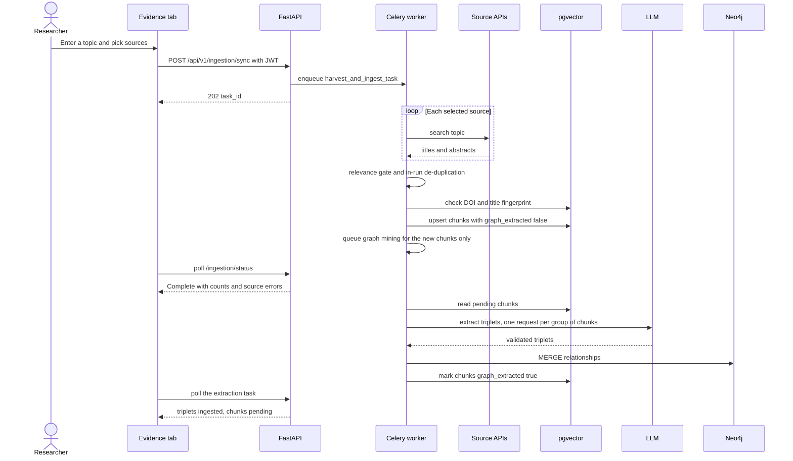

### Relevance gate

Harvested text becomes evidence the validator treats as ground truth, so off-topic content must not get in. A document passes if it contains one **strong** term (`battery`, `cathode`, `anode`, `electrolyte`, `lithium-ion`, `li-ion`, `sodium-ion` and variants) or at least two distinct **weak** terms (`lithium`, `sodium`, `electrode`, `intercalation`, `dendrite`, `capacity retention`, `cycle life` and similar). This keeps a clinical paper on lithium dosing out while keeping a paper on lithium dendrites in.

### De-duplication

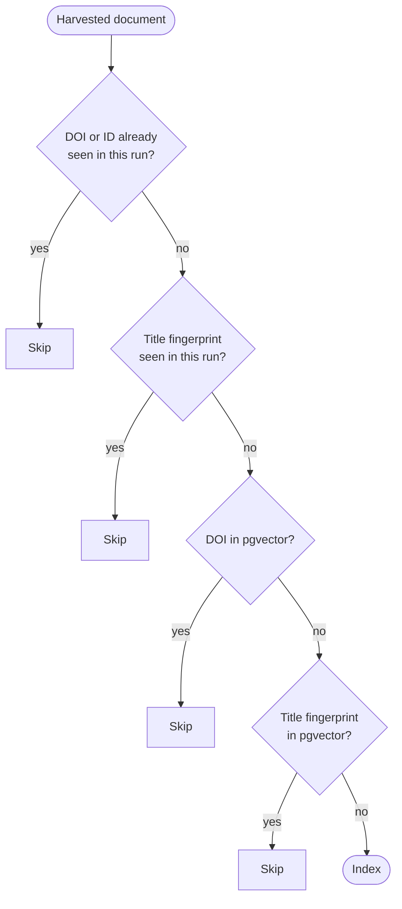

The same paper often arrives from two sources under different identifiers (`arxiv:...` and `doi:...`). A **title fingerprint**, a hash of the lower-cased title with punctuation removed, catches those. Chunk IDs are deterministic (a hash of the document ID and chunk index), so re-indexing is idempotent.

### What is stored

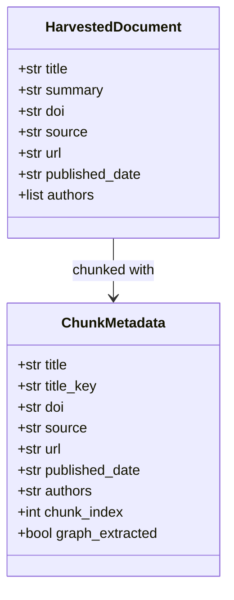

### Graph miner

The graph miner turns chunks into Neo4j facts, and it is bounded because LLM requests are the scarce resource.

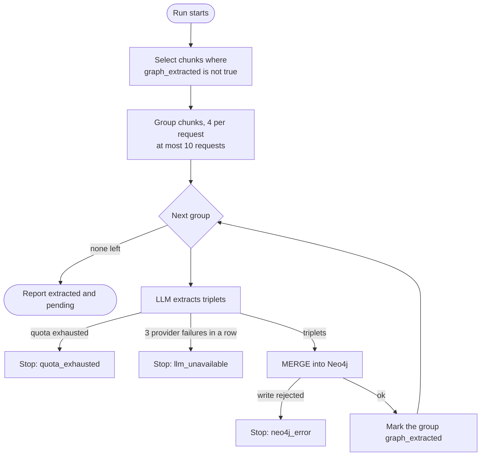

- **Only new work.** A sync restricts the run to the chunks it just indexed. Anything left over stays unflagged and is picked up next time.
- **Validated output.** Triplets are checked against a closed set of node labels and predicates (`CONTAINS`, `CAN_BE_DOPED_WITH`, `EXHIBITS`, `SUFFERS_FROM`, `MITIGATES`) before any Cypher runs.
- **Nothing is marked unless it finished.** A stop leaves unfinished chunks pending, never silently skipped.

### Nightly sweeper

An opt-in scheduled job. It sweeps five fixed battery topics across arXiv, Crossref and PubMed (not Wikipedia), and it counts failed topics instead of reporting success.

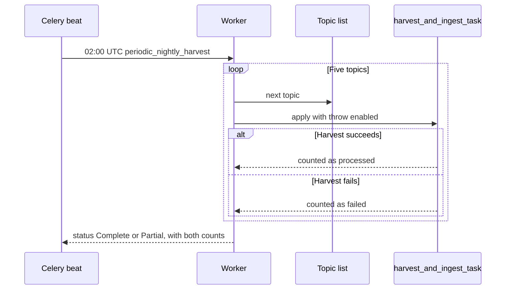

It runs only when **both** are true: `NIGHTLY_HARVEST_ENABLED=true` in `backend/.env`, and a separate `celery beat` process is running.

### Failure semantics

| Situation | Behaviour |
|---|---|
| One source fails | The sync completes, reports `source_errors`, and the UI lists them |
| Every source fails | The task fails with an error naming each source |
| A source returns nothing relevant | Reported as zero results, which is distinct from an error |
| The same paper from two sources | Indexed once |
| LLM quota spent during graph mining | Mining stops, unfinished chunks stay pending, and the result says `quota_exhausted` |
| Neo4j rejects a write | Mining stops with `neo4j_error`, and nothing is marked extracted |

### Triggering a sync

From the UI, open **Dashboard, Evidence graph**, enter a topic, choose sources and select **Harvest Literature**. The panel shows live progress, per-source errors, and the follow-on graph extraction.

From the API:

```bash
curl -X POST http://localhost:8000/api/v1/ingestion/sync \
  -H "Authorization: Bearer $JWT" \
  -H "Content-Type: application/json" \
  -d '{"query": "cobalt-free cathode doping", "sources": ["arxiv", "pubmed"], "max_results": 10}'

curl -H "Authorization: Bearer $JWT" http://localhost:8000/api/v1/ingestion/status/<task_id>
curl -H "Authorization: Bearer $JWT" http://localhost:8000/api/v1/ingestion/stats
```

You can also ingest your own PDFs: unzip them into a folder and run `uv run python -m app.scripts.ingest_papers --dir <folder>` from `backend/`.

---

## API keys and credentials

Every credential lives in `backend/.env`. The frontend only ever sees the public Supabase anon key.

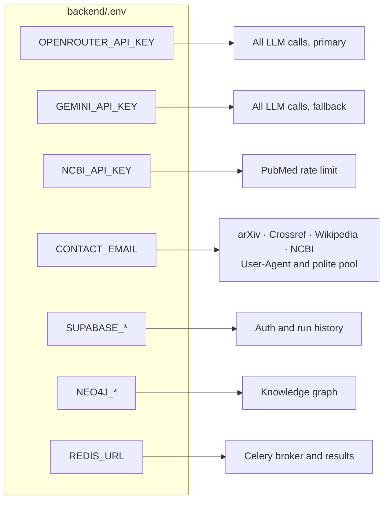

| Variable | Needed | Used by | Where to get it |
|---|---|---|---|
| `SUPABASE_URL`, `SUPABASE_SERVICE_ROLE_KEY`, `SUPABASE_JWT_SECRET` | **Required** | Auth checks, run persistence | Supabase dashboard, Project Settings, API |
| `REDIS_URL` | **Required** | Celery broker and result backend | Upstash console, your database, the `rediss://` connection string |
| `NEO4J_URI`, `NEO4J_USERNAME`, `NEO4J_PASSWORD` | **Required** | Knowledge graph | Neo4j Aura console, `neo4j+s://` URI and generated password |
| `GEMINI_API_KEY` | **Required** | LLM fallback | Google AI Studio, `aistudio.google.com/apikey` |
| `OPENROUTER_API_KEY` | Recommended | Primary LLM through the free router | `openrouter.ai/keys` |
| `NCBI_API_KEY` | Optional | Raises PubMed from 3 to 10 requests per second | NCBI account settings, API Key Management |
| `CONTACT_EMAIL` | Optional, recommended | Identifies the harvester to arXiv, Crossref, Wikipedia and NCBI | Your own address. Blank sends none |
| `HF_API_key` | Optional | Not used in normal operation | Hugging Face settings |

### Per-source credentials

| Source | Credential | What happens without it |
|---|---|---|
| arXiv | None | Works. Be polite: the harvester already throttles |
| Wikipedia | None | Works |
| Crossref | None, `CONTACT_EMAIL` optional | Works from the public pool. With an email you join the faster, friendlier polite pool |
| PubMed | `NCBI_API_KEY` optional | Works at 3 requests per second instead of 10 |

### LLM quota

The OpenRouter free tier allows 50 requests per day, and adding credit raises that to 1000. A discovery run costs about 42 requests and a graph-mining run costs up to 10, so budget accordingly. When the quota is spent, the discovery run fails with a clear message and graph mining stops and leaves its work pending. See [LLM layer, quota and caching](#llm-layer-quota-and-caching).

> Never commit `backend/.env`. It is git-ignored. If a key is ever exposed, rotate it at the provider.

---

## Genetic algorithm

Operators are deterministic code. The LLM is never asked to propose compositions.

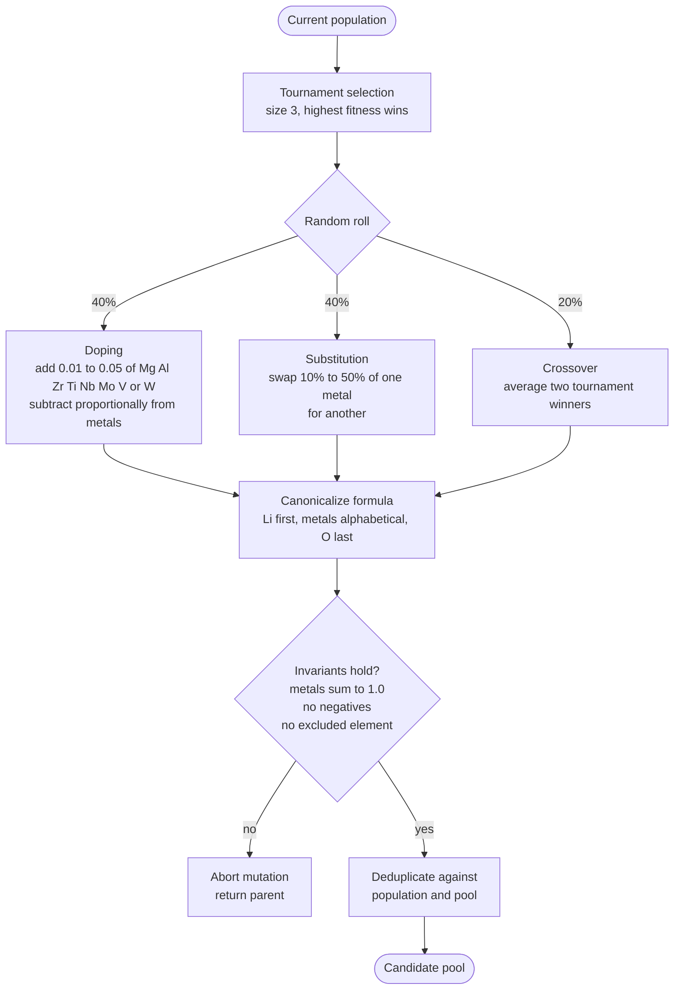

**Invariants**

1. The transition-metal sum is exactly 1.0. Mutations redistribute proportionally and abort rather than produce a negative coefficient.
2. Lithium and oxygen stoichiometry is fixed. Only metals and dopants mutate.
3. Formulas are canonical: Li first, metals alphabetical, O last. Amounts are serialized in fixed-point so a formula always re-parses to the same composition.
4. Excluded elements never enter a genome.
5. The top two candidates carry into the next generation unchanged.

**Fitness**

```text
base    = (specific_capacity × voltage × cycle_life) / cost_usd_per_kg
penalty = 0.2 for each violated target  (capacity_gt, voltage_gt, cycle_life_gt, cost_lt)
fitness = base × penalty
```

Sizing is configurable. Defaults: 10 seeds, 20 candidates per generation, 20 generations.

---

## GraphRAG

Graph rules and literature are fetched concurrently and fused into one context.

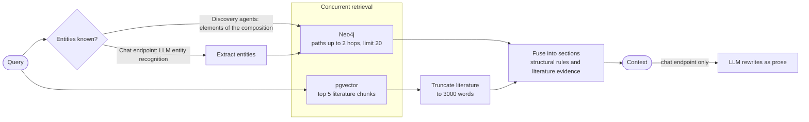

The discovery agents pass element symbols parsed from the composition, which avoids an LLM entity-extraction call on every retrieval. Only the chat endpoint (`/rag/query`) uses LLM extraction.

---

## LLM layer, quota and caching

### Provider strategy

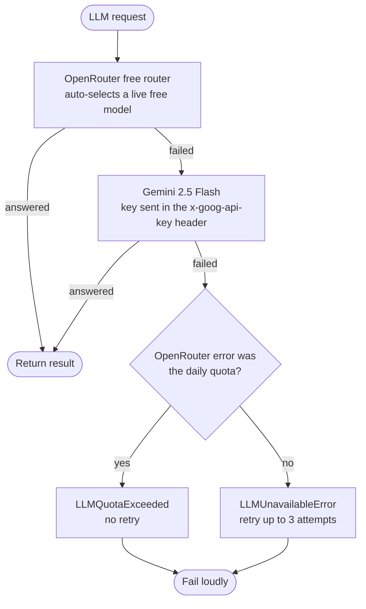

- **No silent degradation.** A prediction that cannot be made fails the run. It is never scored as zero.
- **Quota errors are not retried.** Neither tenacity nor the OpenAI SDK retries a spent daily quota.
- **Secrets stay out of errors.** Provider failures are reported by status or exception type, never with URLs.

### Request budget

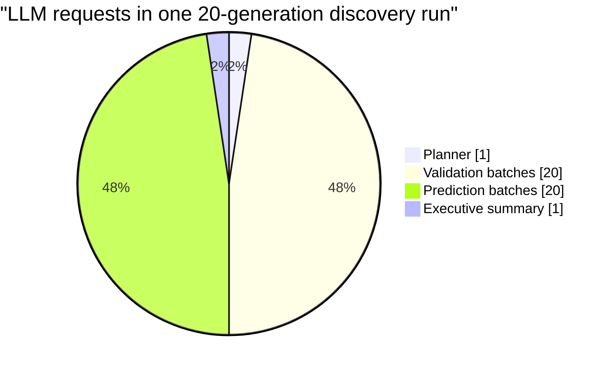

| Work | Requests |
|---|---|
| Discovery run, 20 generations | about 42 |
| Discovery run, 3 generations (for testing) | about 8 |
| Graph-mining run | at most `GRAPH_EXTRACTION_MAX_CALLS` (default 10) |
| Literature harvesting | none, it only calls public source APIs |

### Result caching

Predictions and validity verdicts are cached per worker process in a bounded, expiring cache (`LLM_CACHE_TTL_SECONDS`, `LLM_CACHE_MAX_ENTRIES`). The cache is cleared when ingestion adds literature or graph facts, so results derived from older knowledge are not reused.

---

## Data layer

### Supabase

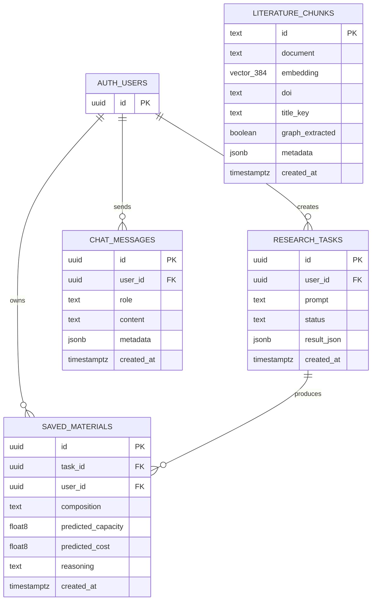

`LITERATURE_CHUNKS` is shared literature, not user data, so it has no foreign keys. It is the only table with `vector(384)`, an HNSW cosine index, and RLS enabled with no policies.

- Create everything by running [`backend/supabase/schema.sql`](backend/supabase/schema.sql) once in the Supabase SQL editor. It is idempotent.
- Row level security is on for every table. The three user tables scope reads and writes to `auth.uid() = user_id`. `literature_chunks` has no policies, so only the service role can reach it.
- The backend uses the **service role key**, which bypasses RLS. The frontend uses the **anon key**, which respects it.
- `ResearchTasks.status` moves from `processing` to `completed` or `failed`. On failure `result_json` holds the reason.
- `chat_messages.metadata` stores the mode and, for Ask answers, the question, cited sources and graph rules, so history restores them.

### Neo4j

```mermaid
flowchart LR
    Material["Material"]
    Element["Element"]
    Property["Property"]
    Degradation["DegradationMode"]
    Role["Role"]

    Material -->|"CONTAINS"| Element
    Material -->|"CAN_BE_DOPED_WITH"| Element
    Material -->|"PREVENTED_BY"| Element
    Material -->|"SUFFERS_FROM"| Degradation
    Material -->|"HAS_ROLE"| Role
    Element -->|"MITIGATES"| Degradation
    Element -->|"INCREASES"| Property
    Element -->|"DECREASES"| Property
    Degradation -->|"REDUCES"| Property
```

- Seeded from 175 ground-truth triplets in [`backend/data/seed_graph.json`](backend/data/seed_graph.json), then extended by the graph miner (which also adds `EXHIBITS`).
- Uniqueness constraints on `Element.symbol`, `Material.name`, `Property.name` and `DegradationMode.name` are created on API startup.
- The driver recycles pooled connections every 300 seconds to stay ahead of Aura's idle timeout.

### pgvector (literature vectors)

- One table, `literature_chunks`, in the Supabase project: `id`, `document`, `embedding vector(384)`, `doi`, `title_key`, `graph_extracted`, `metadata` (jsonb), `created_at`.
- An HNSW index with cosine distance serves similarity search through the `match_literature_chunks` function. Btree indexes on `doi`, `title_key` and pending chunks serve de-duplication and graph mining.
- Row level security is on with no policies, so only the backend's service role reads or writes these rows.
- Create it by running [`backend/supabase/schema.sql`](backend/supabase/schema.sql) once. The script enables the `vector` extension first.
- Embeddings come from fastembed (`all-MiniLM-L6-v2`, computed locally with ONNX).
- Existing ChromaDB data is copied with `uv run --with chromadb python -m app.scripts.migrate_chroma_to_pgvector --path <chroma dir>`. Embeddings are copied, not recomputed.

## Frontend

```mermaid
flowchart TD
    app["App router"] --> pub["Public"]
    app --> prot["ProtectedRoute<br/>requires a Supabase session"]

    pub --> land["/ Landing"]
    pub --> login["/login"]
    pub --> signup["/signup"]

    prot --> dash["/dashboard<br/>redirects to /dashboard/discovery"]
    prot --> res["/results/:taskId<br/>lazy loaded"]
    prot --> set["/settings"]

    dash --> chat["/dashboard/discovery<br/>Chat: Ask or Discover"]
    dash --> ev["/dashboard/evidence<br/>EvidencePanel"]
    dash --> rep["/dashboard/reports<br/>ReportsPanel"]

    chat -->|"Ask: POST /chat/ask"| ans["Grounded answer with sources"]
    chat -->|"Discover: useDiscoveryTask"| poll["Start run, poll every 3s"]
    poll -->|"on Complete"| res
    ev -->|"useIngestionSync"| ing["Harvest, then follow graph mining"]
    rep -->|"open a run"| res
```

### Chat: Ask and Discover

The Discovery space has two modes, switched with the toggle beside the input. **Ask** is the default, and the active mode is always visible.

| Mode | What it does | Cost |
|---|---|---|
| **Ask** | Answers a question from the harvested papers and the knowledge graph, with numbered sources and the graph rules used | One LLM request, and none when there is no evidence |
| **Discover** | Starts the evolutionary search and opens a ranked report | About 42 LLM requests |

```mermaid
flowchart TD
    msg(["Message"]) --> cmd{"Starts with<br/>/ask or /discover?"}
    cmd -->|"yes"| mode{"Mode"}
    cmd -->|"no"| rule{"Does the text fit<br/>the other mode?"}
    rule -->|"no"| mode
    rule -->|"yes"| chip["Ask first:<br/>switch or keep"]
    chip -->|"switch or keep"| mode
    mode -->|"Ask"| ask["POST /api/v1/chat/ask"]
    mode -->|"Discover"| disc["POST /api/v1/research/start"]
    ask --> ans["Answer with sources and graph rules"]
    ans --> follow["Search for candidates based on this"]
    follow --> disc
    disc --> res["Poll, then results page"]
```

- A `/discover` or `/ask` prefix forces the mode for that one message.
- Simple keyword rules compare the text with the selected mode. They only prompt you ("This looks like a design request. Run a discovery instead?"); they never switch silently.
- Messages are saved with their mode, and answers also keep their sources, so the history restores them.

```mermaid
sequenceDiagram
    participant UI as Chat in Ask mode
    participant API as FastAPI chat ask
    participant V as pgvector
    participant G as Neo4j
    participant R as Redis limiter
    participant L as LLM

    UI->>API: question with JWT
    API->>V: nearest literature chunks
    API->>G: rules for the entities in the question
    alt nothing relevant found
        API-->>UI: ungrounded reply, no sources, no LLM call
    else evidence found
        API->>R: count one use for today
        alt over the daily limit
            API-->>UI: 429 with the limit
        else allowed
            API->>L: answer from the numbered context only
            L-->>API: answer or INSUFFICIENT_EVIDENCE
            API-->>UI: answer, sources and rules
        end
    end
```

The answer prompt tells the model to use only the numbered context, to cite `[S1]` and `[R1]` style references, to treat the context as untrusted text, and to reply `INSUFFICIENT_EVIDENCE` when the context cannot answer. A chunk counts as evidence when its cosine distance is at most `ASK_MAX_DISTANCE` (0.75). On the live store, on-topic questions measured about 0.36 to 0.68 and off-topic ones 0.87 and above.

### Evidence panel

The panel drives the knowledge loop. It shows counts for pgvector chunks and Neo4j nodes and relationships, starts a harvest, and follows both the harvest and the graph mining it queues.

```mermaid
stateDiagram-v2
    [*] --> Idle
    Idle --> Submitting: Harvest Literature
    Submitting --> Harvesting: task accepted
    Submitting --> Idle: request rejected, error shown
    Harvesting --> Failed: all sources failed, lost connection or timed out
    Harvesting --> Mining: harvest complete with chunks queued
    Harvesting --> Done: harvest complete, nothing new
    Mining --> Done: extraction complete
    Mining --> Done: extraction stopped early, reason shown
    Failed --> Idle: try again
    Done --> Idle: new sync
```

- A store that cannot be reached shows a dash and a warning, never a misleading zero.
- Polling never overlaps requests, ends in a failure after repeated errors or ten minutes, and stops when you leave the page.
- The nightly sweep card shows whether the sweep is actually enabled.

### Results dashboard

```mermaid
flowchart TD
    page["Results page"] --> sum["Executive summary"]
    page --> evo["Evolution chart<br/>best vs average score per generation"]
    page --> cards["Material cards<br/>top 5 with radar vs NMC811 baseline"]
    page --> kg["Knowledge graph<br/>force-directed, material selector"]
    page --> pdf["Download full report<br/>html2canvas and jsPDF, loaded on demand"]
    kg -->|"GET /api/v1/graph/material/name"| api["FastAPI graph endpoint"]
```

Knowledge graph colors: gold for Material, blue for Element, green for Property, red for DegradationMode.

---

## Security

```mermaid
sequenceDiagram
    participant B as Browser
    participant S as Supabase Auth
    participant A as FastAPI
    participant D as Supabase Postgres

    B->>S: Sign in
    S-->>B: JWT
    B->>A: Request with Bearer JWT
    A->>S: get_user(token)
    S-->>A: user or 401
    A->>D: write with service role key
    B->>D: read history with anon key and JWT
    D-->>B: only rows where user_id equals auth.uid()
```

| Area | Practice |
|---|---|
| Authentication | `POST /research/start`, `POST /chat/ask`, `POST /rag/query`, every `/ingestion` route, `/test-celery` and `/task/{id}` require a valid Supabase JWT |
| Authorization | Row level security on every table, scoped to `auth.uid()` |
| Secrets | Backend `.env` only. Keys never reach the browser |
| Keys in transit | The Gemini key travels in the `x-goog-api-key` header, never in a URL, so it cannot leak through logs |
| LLM spend | Ask answers are limited per user per day (`ASK_DAILY_LIMIT`), and a question with no evidence never calls the LLM |
| Error responses | Health and RAG errors are generic. Provider and source failures report status or type, never URLs |
| Ingestion input | Sources are a closed set, queries are trimmed and capped at 200 characters, and results per source are capped at 50 |
| Harvested content | Relevance-filtered before indexing. XML from arXiv and PubMed is parsed with `defusedxml` |
| Graph writes | Triplets are validated against closed label and predicate sets before any Cypher runs |
| CORS | Allow-listed to the local Vite origin. Add your production origin in `backend/main.py` |

---

## Quick start

> No Docker, no local Redis and no local Neo4j are needed. AURA runs against managed Upstash Redis, Supabase and Neo4j Aura, and you run everything from the terminal.

### Prerequisites

| Requirement | Notes |
|---|---|
| Python 3.12 and [uv](https://docs.astral.sh/uv/getting-started/installation/) | uv reads `.python-version` and `uv.lock` |
| Node.js 20.19+ or 22.12+ | Frontend build tooling (Vite 8 requires this range) |
| Supabase project | Auth and Postgres. The free tier is fine |
| Upstash Redis database | Copy the `rediss://` connection string |
| Neo4j | An AuraDB free instance, or a local server |
| API keys | See [API keys and credentials](#api-keys-and-credentials) |

```mermaid
flowchart LR
    a["1 Create cloud services<br/>Supabase · Upstash · Aura"] --> b["2 uv sync<br/>and fill .env"]
    b --> c["3 One-time setup<br/>schema.sql · Neo4j seed"]
    c --> d["4 Start API"]
    d --> e["5 Start worker"]
    e --> f["6 Start frontend"]
    f --> g["7 Harvest literature<br/>from the Evidence tab"]
    g --> h(["8 Run a discovery"])
```

### 1. Backend

```bash
cd backend
uv sync                         # creates .venv with the locked dependencies
cp .env.example .env            # then fill it in
```

Minimum `backend/.env`:

```dotenv
SUPABASE_URL=https://<project>.supabase.co
SUPABASE_SERVICE_ROLE_KEY=<service-role-key>
SUPABASE_JWT_SECRET=<jwt-secret>

REDIS_URL=rediss://default:<password>@<name>.upstash.io:6379   # plain URL, no query string

NEO4J_URI=neo4j+s://<id>.databases.neo4j.io
NEO4J_USERNAME=neo4j
NEO4J_PASSWORD=<password>

OPENROUTER_API_KEY=<key>
GEMINI_API_KEY=<key>

# Recommended for the paper harvesters
CONTACT_EMAIL=you@example.org
NCBI_API_KEY=                   # optional
```

TLS for `rediss://` is configured in code. Do not append `?ssl_cert_reqs=...` to the URL.

### 2. One-time setup

```bash
# a) Supabase: run backend/supabase/schema.sql once in the SQL editor.
#    It enables the pgvector extension and creates ResearchTasks, SavedMaterials, chat_messages,
#    literature_chunks, their indexes, the match_literature_chunks function and RLS policies.

# b) Seed the Neo4j knowledge graph (from backend/)
uv run python -m app.scripts.seed_neo4j
```

Neo4j constraints are created automatically when the API starts. To start with literature already in place, unzip your PDFs into a folder and run `uv run python -m app.scripts.ingest_papers --dir <folder>`. Otherwise, use the Evidence tab after the app is running.

### 3. Run the processes

```bash
# Terminal 1: API (from backend/)
uv run uvicorn main:app --reload --port 8000
```

```bash
# Terminal 2: Celery worker (from backend/)
uv run celery -A app.core.celery_app.celery_app worker --loglevel=info
```

```bash
# Terminal 3: frontend (from frontend/)
npm install
cp .env.example .env            # set the Supabase URL and anon key, and VITE_API_DEV_URL
npm run dev                     # http://localhost:5173
```

```bash
# Optional, only for the nightly literature sweep: set NIGHTLY_HARVEST_ENABLED=true first
uv run celery -A app.core.celery_app.celery_app beat --loglevel=info
```

On macOS and Windows the worker automatically uses Celery's `solo` pool, because the default `prefork` pool fails under `spawn`. Linux keeps `prefork`.

Frontend `.env`:

```dotenv
VITE_API_DEV_URL=http://127.0.0.1:8000
VITE_API_PRO_URL=https://<your-deployed-api>
VITE_MODE=development
VITE_SUPABASE_URL=https://<project>.supabase.co
VITE_SUPABASE_ANON_KEY=<anon-key>
```

### 4. Verify

```bash
curl http://localhost:8000/api/v1/health
curl http://localhost:8000/api/v1/health/db        # neo4j, pgvector, supabase
```

For a first real run, set `GA_GENERATIONS=3` in `backend/.env`. A discovery then costs about 8 LLM requests instead of 42.

### 5. Use it

1. Sign up, then open the dashboard.
2. Open **Evidence graph**, enter a topic such as "cobalt-free cathode doping", and harvest literature.
3. Open **Discovery space**. In **Ask** mode, the default, type a question such as "What do the papers say about LFP cycle life?" and read the answer with its sources.
4. Switch to **Discover**, or start a message with `/discover`, and describe the material you want. You are redirected to the results page when the run finishes.

---

## API reference

All routes are mounted under `/api/v1`.

| Method | Endpoint | Auth | Purpose |
|---|---|---|---|
| `GET` | `/health` | none | Liveness |
| `GET` | `/health/db` | none | Neo4j, pgvector and Supabase connectivity |
| `POST` | `/test-celery?iterations=n` | JWT | Queue a dummy task, `n` from 1 to 20 |
| `GET` | `/task/{task_id}` | JWT | Raw Celery task state |
| `POST` | `/research/start` | JWT | Start a discovery run. Body `{ "prompt": "..." }` |
| `GET` | `/research/status/{task_id}` | none | Progress, final report or failure reason |
| `POST` | `/chat/ask` | JWT | Grounded answer from the literature and graph. Body `{ "question": "..." }` |
| `POST` | `/rag/query` | JWT | Raw GraphRAG context and an LLM rewrite for a chemistry question |
| `GET` | `/graph/material/{material_name}` | none | `{ nodes, links }` graph for a formula |
| `POST` | `/ingestion/sync` | JWT | Start a harvest. Body `{ query, sources, max_results }` |
| `GET` | `/ingestion/status/{task_id}` | JWT | Progress of a harvest or of the graph mining it queued |
| `GET` | `/ingestion/stats` | JWT | pgvector and Neo4j counts, store errors, nightly flag |

### Discovery status shapes

| State | Response |
|---|---|
| Pending | `{ "status": "Pending...", "generation": 0, "best_score": 0.0 }` |
| In progress | `{ "status": "Completed Generation 5...", "generation": 5, "best_score": 450.2 }` |
| Complete | `{ "status": "Complete", "results": [...], "executive_summary", "generation_history": [...] }` |
| Failed | `{ "status": "Failed", "error": "..." }` |

### Ingestion request and status

`POST /ingestion/sync` accepts `sources` as any of `arxiv`, `wikipedia`, `crossref`, `pubmed` or `all`, with `max_results` from 1 to 50 per source.

| State | Notable fields |
|---|---|
| In progress | `stage` (`fetching`, `deduplicating`, `extracting_triplets`), `papers_found`, `new_papers_indexed`, `triplets_ingested` |
| Complete (harvest) | `new_papers_indexed`, `source_errors`, `extraction_task_id` |
| Complete (graph mining) | `chunks_extracted`, `chunks_pending`, `triplets_ingested`, `stopped_reason` |
| Failed | `error` |

### Ask request and response

`POST /chat/ask` takes a `question` of 3 to 1000 characters.

| Field | Meaning |
|---|---|
| `answer` | The grounded answer, or a standard "not enough evidence" message |
| `grounded` | `false` when no evidence was found or the model judged it insufficient |
| `sources` | Numbered `S1`, `S2`, ...: `title`, `doi`, `url`, `source`, `snippet`, `distance` |
| `graph_rules` | Knowledge-graph rules used, such as `NMC811 CAN_BE_DOPED_WITH Mg` |
| `remaining_today` | Answers left today, or `null` when none was counted |

Errors: `429` when the daily limit is used up, `503` when the LLM quota is spent or the model or literature search is unavailable, and `422` for an invalid question.

### Example

```bash
# Start a discovery run
curl -X POST http://localhost:8000/api/v1/research/start \
  -H "Authorization: Bearer $JWT" -H "Content-Type: application/json" \
  -d '{"prompt": "Find a cathode with >280 mAh/g capacity, <50$/kg, without Cobalt"}'

# Poll it
curl http://localhost:8000/api/v1/research/status/<task_id>

# Ask a question grounded in your harvested papers
curl -X POST http://localhost:8000/api/v1/chat/ask \
  -H "Authorization: Bearer $JWT" -H "Content-Type: application/json" \
  -d '{"question": "What do the papers say about LFP cathode cycle life?"}'

# Explore the chemistry behind a candidate
curl "http://localhost:8000/api/v1/graph/material/LiNi0.5Mn0.5O2"
```

---

## Configuration reference

### Backend

| Variable | Required | Default | Purpose |
|---|---|---|---|
| `SUPABASE_URL`, `SUPABASE_SERVICE_ROLE_KEY`, `SUPABASE_JWT_SECRET` | yes | | Supabase access |
| `REDIS_URL` | yes | | Upstash `rediss://...` string |
| `NEO4J_URI`, `NEO4J_USERNAME`, `NEO4J_PASSWORD` | yes | | Neo4j connection |
| `GEMINI_API_KEY` | yes | | Fallback LLM |
| `OPENROUTER_API_KEY` | recommended | none | Primary LLM. Without it AURA uses Gemini only |
| `HF_API_key` | no | none | Not used in normal operation |
| `NCBI_API_KEY` | no | none | Faster PubMed requests |
| `CONTACT_EMAIL` | no | blank | Sent to source APIs. Blank sends none |
| `GA_GENERATIONS` | no | `20` | Generations per discovery run |
| `GA_SEED_POPULATION` | no | `10` | Initial population size |
| `GA_POPULATION_SIZE` | no | `20` | Candidates per generation |
| `GRAPH_EXTRACTION_MAX_CALLS` | no | `10` | LLM requests per graph-mining run |
| `GRAPH_EXTRACTION_GROUP_SIZE` | no | `4` | Chunks sent per LLM request |
| `NIGHTLY_HARVEST_ENABLED` | no | `false` | Registers the 02:00 UTC sweep. Needs `celery beat` |
| `ASK_DAILY_LIMIT` | no | `30` | Grounded Ask answers per user per UTC day |
| `ASK_MAX_DISTANCE` | no | `0.75` | Cosine distance above which a literature chunk is not treated as evidence |
| `LLM_CACHE_TTL_SECONDS` | no | `3600` | Lifetime of cached predictions and verdicts |
| `LLM_CACHE_MAX_ENTRIES` | no | `5000` | Size bound of each cache |
| `DATABASE_URL` | no | | Only for the legacy `setup_chat_table.py` script |

### Frontend

| Variable | Purpose |
|---|---|
| `VITE_API_DEV_URL`, `VITE_API_PRO_URL` | API base URL for development and production. An empty production URL means same origin |
| `VITE_MODE` | `development` or `production` |
| `VITE_SUPABASE_URL`, `VITE_SUPABASE_ANON_KEY` | Public Supabase credentials |

---

## Testing and verification

```bash
cd backend
uv run pytest                    # backend suite
uv run pytest -v
uv run pytest tests/test_ingestion_pipeline.py -v
```

| Suite | Covers |
|---|---|
| `test_ga_phase5.py`, `test_material_roundtrip.py` | Formula parsing, operators, round-trip safety, long mutation chains |
| `test_fitness_phase7.py`, `test_ga_settings.py` | Fitness and configurable sizing |
| `test_graphrag_unit.py`, `test_composition_entities.py` | GraphRAG fusion and composition-derived entities |
| `test_batch_prediction.py`, `test_batch_validation.py` | Batched LLM calls, caches, retries |
| `test_quota_failfast.py`, `test_gemini_key_header.py` | Quota handling and key hygiene |
| `test_harvesters.py`, `test_harvester_quality.py` | Source parsing, formula preservation, query building, relevance, de-duplication |
| `test_ingestion_pipeline.py`, `test_ingestion_api.py` | Harvest task, incremental graph mining, nightly sweep, stats |
| `test_api_hardening.py` | Authentication, input validation, error hygiene |
| `test_chat_ask.py` | Ask endpoint branches, source grouping, the daily limiter, the answer prompt, graph rules |
| `test_runtime_robustness.py` | Cache expiry, recursion limit, long runs |
| `test_reporter_phase8.py` | Reporter and graph construction |

Scripts that exercise the real code without spending quota:

```bash
# A full discovery run against a fake LLM, counting requests
uv run python -m app.scripts.simulate_discovery_run --generations 20

# The ingestion tasks against the live pgvector store, with fake sources and LLM (cleans up its rows)
uv run python -m app.scripts.verify_ingestion_pipeline

# The same discovery graph against the real services (spends quota)
uv run python -m app.scripts.simulate_discovery_run --generations 2 --live

# The Ask endpoint against the live store, graph, limiter and LLM (one LLM request)
uv run python -m app.scripts.verify_chat_ask

# POST /research/start against the real database, with queueing replaced (no quota, cleans up)
uv run python -m app.scripts.verify_chat_discover
```

Frontend:

```bash
cd frontend
npm run lint
npm run build
npm test                         # frontend suite, Node's built-in test runner
```

---

## Production deployment

```mermaid
flowchart LR
    users(["Users"]) --> cdn["Static host<br/>React build"]
    cdn -->|"HTTPS"| apisvc["API service<br/>uvicorn"]
    apisvc --> up[("Upstash Redis")]
    apisvc --> sb[("Supabase")]
    up --> wk["Worker service<br/>celery, prefork on Linux"]
    up --> bt["Beat service, optional<br/>one instance only"]
    wk --> sb
    wk --> n4[("Neo4j Aura")]
    wk --> llm["OpenRouter and Gemini"]
    wk --> src["arXiv · Crossref · PubMed · Wikipedia"]
```

| Item | Detail |
|---|---|
| Frontend | `npm run build`, serve `frontend/dist`, set `VITE_API_PRO_URL` and `VITE_MODE=production` |
| API | `uv run uvicorn main:app --host 0.0.0.0 --port $PORT` behind HTTPS |
| Worker | `uv run celery -A app.core.celery_app.celery_app worker --loglevel=info --concurrency N` |
| Beat | Exactly one instance, only if `NIGHTLY_HARVEST_ENABLED=true` |
| CORS | Add the production origin to `allow_origins` in `backend/main.py` |
| Vector store | pgvector in Supabase, so nothing to mount. Run `backend/supabase/schema.sql` once per project |
| LLM capacity | The free tier is about one discovery run a day. Add OpenRouter credit for sustained use |
| Secrets | Inject from your platform. Never commit `.env` |
| Health checks | Probe `/api/v1/health` and `/api/v1/health/db` |

`backend/Dockerfile` and `backend/docker-compose.yml` are placeholders and are not maintained or tested. The supported way to run AURA is from the terminal as described above.

---

## Project structure

```text
AURA_Data_Driven/
├── backend/
│   ├── app/
│   │   ├── core/                    # config, JWT auth, Celery app and beat schedule
│   │   ├── db/                      # Supabase and Neo4j clients, literature store, Neo4j constraints
│   │   ├── api/v1/
│   │   │   ├── endpoints/           # health, research, chat, rag, graph, ingestion
│   │   │   │                        # analysis.py and strategy.py are empty placeholders
│   │   │   └── router.py
│   │   ├── agents/
│   │   │   ├── state.py             # ResearchState
│   │   │   ├── workflow.py          # LangGraph wiring and recursion limit
│   │   │   └── nodes/               # planner, mutator, predictor, reporter
│   │   ├── services/
│   │   │   ├── ga/                  # material, operators, population, fitness
│   │   │   ├── harvesters/          # arxiv, crossref, pubmed, wikipedia, relevance, deduplicator
│   │   │   ├── ingestion/           # PDF parser, chunker, upsert
│   │   │   ├── graph/               # triplet extractor and Neo4j ingestion
│   │   │   ├── retrieval/           # vector, graph, GraphRAG fusion
│   │   │   ├── llm/                 # client (batched calls) and error types
│   │   │   ├── cache.py             # bounded expiring caches for LLM results
│   │   │   ├── rate_limit.py        # per-user daily limit in Redis
│   │   │   └── embeddings.py        # local ONNX embedding function
│   │   ├── models/                  # Pydantic schemas
│   │   └── scripts/                 # seeding, PDF ingestion, simulators, manual checks
│   ├── worker/tasks.py              # Celery tasks: discovery, harvest, graph mining, nightly sweep
│   ├── data/                        # seed_graph.json
│   ├── supabase/schema.sql          # tables and RLS policies
│   ├── tests/
│   ├── main.py                      # FastAPI app, lifespan, CORS
│   ├── pyproject.toml               # dependencies, the source of truth
│   ├── uv.lock                      # locked versions
│   ├── .python-version
│   ├── requirements.txt             # generated export for non-uv tooling
│   └── .env.example
├── frontend/
│   ├── src/
│   │   ├── pages/                   # Landing, Login, Signup, Dashboard, Results, Settings
│   │   ├── components/              # landing, dashboard (Chat, Evidence, Reports), results, shared
│   │   ├── hooks/                   # useDiscoveryTask, useIngestionSync
│   │   ├── lib/                     # api, supabase, pollIngestionTask, chatIntent, PDF export, baseline
│   │   ├── store/                   # Zustand research store
│   │   ├── contexts/                # auth context
│   │   └── types/                   # research, ingestion and chat types
│   └── tests/                       # polling tests
├── docs/                            # PRD, TRD, GA design
├── phases/                          # phase_0 to phase_8 build plan
├── upgrade/                         # LLM call reduction plan
├── Images/                          # screenshots
├── PPT/                             # review deck
├── CLAUDE.md                        # developer conventions
└── README.md
```

---

## Troubleshooting

| Symptom | Cause | Fix |
|---|---|---|
| Worker logs `Error 61 ... Connection refused` to Upstash | The network blocks port 6379, or the database is paused or deleted | Try a phone hotspot. If it still fails, check the database in the Upstash console and update `REDIS_URL` |
| Worker cannot connect and the URL has `?ssl_cert_reqs=` | redis-py rejects that value | Use the plain `rediss://` URL. TLS is set in code |
| Celery warns about `ssl_cert_reqs=CERT_NONE` | TLS certificate verification is disabled by configuration | Expected. See [Known limitations](#known-limitations) |
| Run ends `Failed` with a quota message | OpenRouter's free tier is spent and Gemini also failed | Wait for the 00:00 UTC reset, add OpenRouter credit, or set `GA_GENERATIONS=3` |
| Evidence tab shows a dash and a warning | pgvector or Neo4j is unreachable | Check `/api/v1/health/db`, then the store named in the warning |
| Sync fails with "All literature sources failed" | No source could be reached | Check your network. The task error names each source and its status |
| Sync completes with some `source_errors` | One source returned an error or was rate limited | Re-run later. Other sources were still indexed |
| Graph mining reports `quota_exhausted` | The LLM quota ran out mid-run | Nothing is lost. Unfinished chunks stay pending for the next run |
| Nightly sweep never runs | It is off by default and needs its own process | Set `NIGHTLY_HARVEST_ENABLED=true` and run `celery beat` |
| Neo4j `Unable to retrieve routing information` | The Aura instance is paused or restarting | Resume it in the Aura console and use the `neo4j+s://` URI |
| "Research reports" empty or database errors | Supabase tables are missing | Run `backend/supabase/schema.sql` |
| Ask replies that it lacks evidence | No harvested chunk is close enough to the question | Harvest papers on the topic from the Evidence tab, or rephrase the question |
| Ask returns HTTP 429 | `ASK_DAILY_LIMIT` answers used for today (UTC) | Wait for the day to roll over, use Discover, or raise the limit |
| Ask returns HTTP 503 with a quota message | The OpenRouter free tier is spent and Gemini also failed | Wait for the 00:00 UTC reset or add OpenRouter credit |
| Literature search or Evidence stats report a pgvector error | The `vector` extension, `literature_chunks` table or `match_literature_chunks` function is missing | Run `backend/supabase/schema.sql` in the Supabase SQL editor |
| Browser CORS error against a deployed API | The origin is not allow-listed | Add it in `backend/main.py` |
| `uv run pytest` cannot import `app` | Running from outside `backend/` | Run from `backend/`, where `pyproject.toml` sets the import path |

---

## Known limitations

- `GET /research/status` and `/graph/material` are unauthenticated. Task IDs are unguessable, but these should sit behind authentication before wide exposure.
- Redis TLS uses `ssl.CERT_NONE`, so the broker certificate is not verified. Switch to `CERT_REQUIRED` for strict verification.
- Harvesting reads titles and abstracts or summaries only. Full-text PDFs are ingested separately through `ingest_papers`.
- Graph triplets are extracted by an LLM and are not human-verified. Provenance is not stored on graph edges, so a bad fact cannot yet be traced back to its source paper.
- The relevance gate is keyword-based. It removes clearly off-topic content but is not a semantic classifier.
- Literature vectors share the Supabase project's database and storage quota, so a very large corpus eventually needs a larger plan.
- A discovery run uses about 42 LLM requests, which is most of the free-tier daily quota.
- Ask answers use only the harvested literature and the graph, so a topic with no harvested papers gets no answer until some are added. The mode suggestions are keyword rules and can miss unusual phrasing.
- CORS allows only the local development origin until you add your own.
- `analysis.py` and `strategy.py` under `app/api/v1/endpoints/` are empty placeholders, and the Docker files are unmaintained placeholders.

---

## Documentation, contributing and license

| Document | Description |
|---|---|
| [`docs/PRD.md`](docs/PRD.md) | Product requirements |
| [`docs/TRD.md`](docs/TRD.md) | Technical requirements |
| [`docs/GA.md`](docs/GA.md) | Genetic algorithm design |
| [`phases/`](phases) | Phase-by-phase build plan |
| [`upgrade/llm_call_reduction.md`](upgrade/llm_call_reduction.md) | LLM call reduction plan |
| [`CLAUDE.md`](CLAUDE.md) | Developer conventions and workflow |

**Contributing.** Branch from `main` using `feat/<name>` or `fix/<name>`, keep commits focused and in [Conventional Commits](https://www.conventionalcommits.org) form (`feat:`, `fix:`, `docs:`, `test:`, `perf:`, `build:`, `chore:`), run `uv run pytest` and `npm run lint` before pushing, and open a pull request.

**License.** Released under the [Apache License 2.0](LICENSE).
