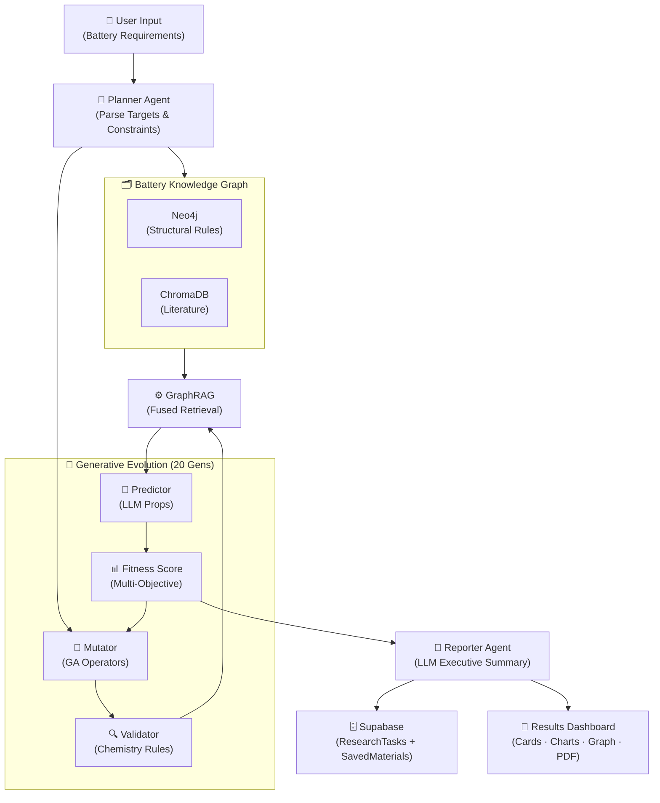
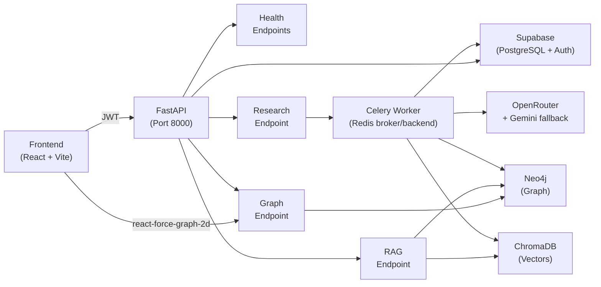
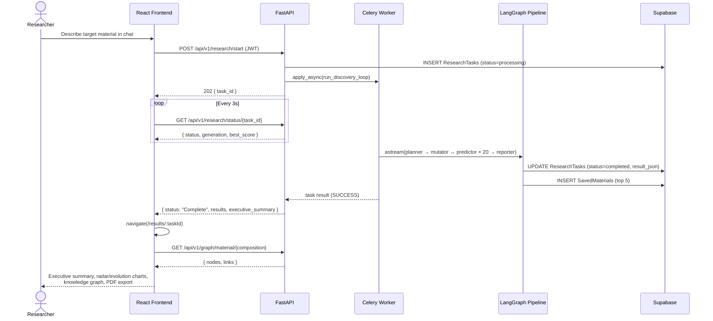
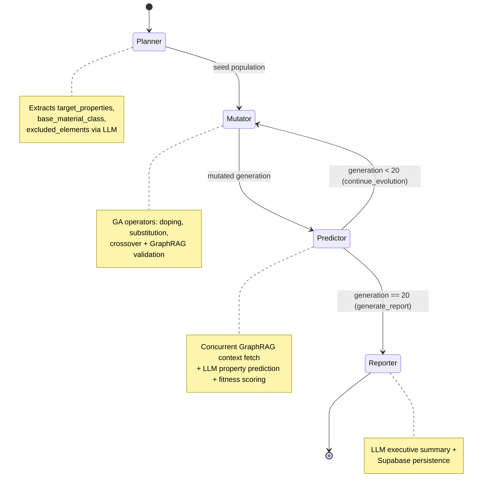
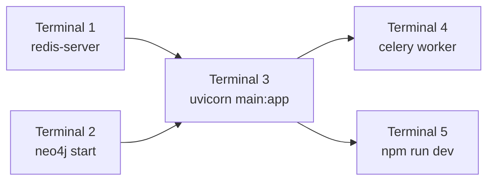
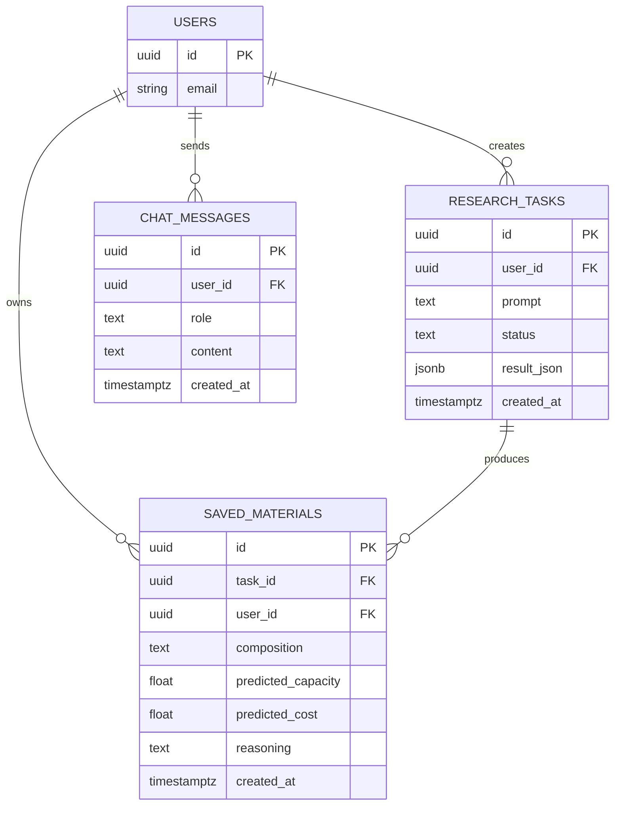
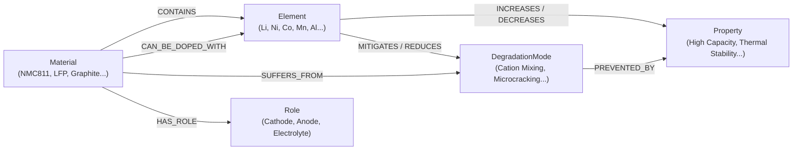
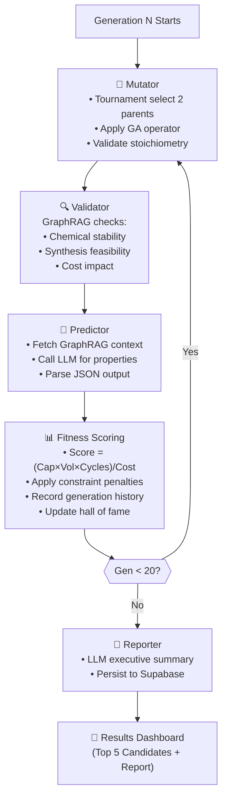
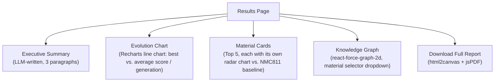

<h1 align="center">AURA: Autonomous Unified Research Assistant for Battery Materials Discovery</h1>

<p align="center">
  <em>AI-powered discovery of novel battery materials through intelligent multi-agent evolution, knowledge graphs, and LLM-based property prediction.</em>
</p>

<p align="center">
  
  
  
</p>

---

## 📋 Overview

AURA is a domain-specific research assistant for accelerating battery material discovery. Instead of generic text generation, it intelligently evolves known battery compositions using:

- **Genetic Algorithm (GA)** for stoichiometrically-sound mutations
- **GraphRAG** for chemistry validation against literature and structural rules
- **LLM-based Property Prediction** for electrochemical property estimation
- **Multi-Agent Orchestration (LangGraph)** for seamless workflow coordination
- **Automated Reporting** with an LLM-written executive summary, interactive charts, an explorable knowledge graph, and one-click PDF export

**Key insight:** Evolution is guided by chemistry, not chance. Every mutated candidate respects valence rules, stoichiometry constraints, and real synthesis feasibility before being evaluated.

---

## 🛠 Technology Stack

<p align="center">
  
  
  
  
  
  
  
  
  
  <br/>
  
  
  
  
  
  
  
  
  
  
  
  
</p>

| Layer | Technology | Purpose |
|-------|-----------|---------|
| **Frontend Framework** | React 19, Vite 8, TypeScript (strict), TailwindCSS v4 | SPA shell, build tooling, and utility-first styling |
| **Frontend State** | Zustand, React Context, React Hook Form, Zod | Research task state, auth state, form validation |
| **Frontend Routing** | React Router v7 | Landing/auth/dashboard/results routes, protected routes |
| **Data Visualization** | Recharts (radar + line charts), `react-force-graph-2d` | Fitness evolution charts, interactive chemistry knowledge graph |
| **UI Motion & Feel** | Framer Motion, Lenis, Lucide React, `@hello-pangea/dnd` | Scroll-triggered/stagger animations, smooth scroll, icons, drag-and-drop |
| **Reporting Export** | `jspdf`, `html2canvas` | Client-side "Download Full Report" PDF export |
| **Backend Framework** | FastAPI, Python 3.12, Pydantic v2, Uvicorn | REST API, request/response validation, ASGI server |
| **AI Orchestration** | LangGraph | Multi-agent (planner → mutator → predictor → reporter) workflow graph |
| **Async Tasks** | Celery + Redis | Long-running discovery tasks with progress polling |
| **Auth & Relational Data** | Supabase (PostgreSQL + Auth, `supabase-py`) | JWT auth, `ResearchTasks`, `SavedMaterials`, `chat_messages` |
| **Knowledge Graph** | Neo4j (`neo4j` driver) | Structural chemistry rules, elements/materials/properties/degradation modes |
| **Vector Store** | ChromaDB (local persistent) | Battery literature + material property embeddings |
| **Embeddings** | ChromaDB `DefaultEmbeddingFunction` (local ONNX `all-MiniLM-L6-v2`) | Fully offline semantic embeddings — no external embedding API call |
| **LLM Providers** | OpenRouter (free-tier models) → Gemini 2.5 Flash fallback | Entity extraction, property prediction, executive summaries |
| **Document Ingestion** | PyMuPDF, `langchain-text-splitters` | PDF parsing and chunking for the literature corpus |
| **Resilience** | `tenacity` (retry + exponential backoff) | LLM and GraphRAG call resilience |
| **Testing** | Pytest, `pytest-asyncio`, ESLint, `tsc` | Backend unit tests; frontend type-checking and linting |

---

## 🏗 System Architecture



### Component Architecture



### End-to-End Request Lifecycle



---

## 🧬 Multi-Agent Pipeline (LangGraph)



---

## 📁 Project Structure

```
AURA_Data_Driven/
├── backend/                          # FastAPI + LangGraph engine
│   ├── app/
│   │   ├── core/                    # Config, JWT auth, Celery app setup
│   │   ├── db/                      # Supabase, Neo4j, ChromaDB clients
│   │   ├── api/v1/
│   │   │   ├── endpoints/
│   │   │   │   ├── health.py       # DB health checks
│   │   │   │   ├── research.py     # Discovery task start/status API
│   │   │   │   ├── rag.py          # GraphRAG query endpoint
│   │   │   │   └── graph.py        # Material knowledge-graph endpoint
│   │   │   └── router.py
│   │   ├── agents/                  # LangGraph multi-agent pipeline
│   │   │   ├── state.py            # ResearchState schema
│   │   │   ├── workflow.py         # Graph wiring (planner→mutator↔predictor→reporter)
│   │   │   └── nodes/
│   │   │       ├── planner.py      # Parse user requirements, seed population
│   │   │       ├── mutator.py      # Genetic Algorithm evolution
│   │   │       ├── predictor.py    # LLM property prediction + fitness
│   │   │       └── reporter.py     # Executive summary + Supabase persistence
│   │   ├── services/                # Business logic
│   │   │   ├── ga/                 # Genetic algorithm
│   │   │   │   ├── material.py     # Material stoichiometry parser/validator
│   │   │   │   ├── operators.py    # Doping, substitution, crossover
│   │   │   │   ├── population.py   # Tournament selection
│   │   │   │   └── fitness.py      # Multi-objective scoring + penalties
│   │   │   ├── ingestion/          # PDF parsing, chunking, upsert into ChromaDB
│   │   │   ├── retrieval/          # Vector search, graph search, GraphRAG fusion
│   │   │   ├── graph/               # Neo4j triplet extraction + ingestion
│   │   │   ├── llm/                # OpenRouter + Gemini client (predict/validate/summarize)
│   │   │   └── embeddings.py       # Local ONNX embedding function
│   │   ├── models/                  # Pydantic schemas (graph triplets, etc.)
│   │   └── scripts/                 # Setup, seeding, and manual test scripts
│   ├── worker/
│   │   └── tasks.py                # Celery task definitions (run_discovery_loop)
│   ├── tests/                       # pytest suite (15 tests)
│   ├── supabase/
│   │   └── schema.sql               # Reference DDL for ResearchTasks/SavedMaterials/chat_messages
│   ├── main.py                      # FastAPI app entry + lifespan + CORS
│   ├── pyproject.toml              # Dependencies (source of truth)
│   ├── uv.lock                     # Locked versions, committed
│   ├── .python-version
│   ├── requirements.txt            # Generated export for non-uv tooling
│   ├── .env.example
│   └── docker-compose.yml           # Optional containerized Redis for local dev
│
├── frontend/                         # React + Vite UI
│   ├── src/
│   │   ├── pages/                  # LandingPage, Login, Signup, Dashboard, Results, Settings
│   │   ├── components/
│   │   │   ├── landing/            # Hero, Features, HowItWorks, CallToAction
│   │   │   ├── dashboard/          # ChatInterface (discovery launcher + live progress)
│   │   │   ├── results/            # MaterialCard, EvolutionChart, MaterialGraph
│   │   │   └── shared/             # AuraMark, ProtectedRoute
│   │   ├── contexts/                # AuthContext / useAuth (Supabase session)
│   │   ├── hooks/
│   │   │   └── useDiscoveryTask.ts # Starts + polls a discovery task, redirects on completion
│   │   ├── store/                  # Zustand research task state
│   │   ├── types/                  # Shared research/graph TypeScript types
│   │   ├── lib/
│   │   │   ├── api.ts             # Axios instance + JWT interceptor
│   │   │   ├── supabase.ts        # Supabase client (nullable in local preview)
│   │   │   ├── baseline.ts        # NMC811 baseline constants for radar charts
│   │   │   └── exportReportPdf.ts # html2canvas + jsPDF report export
│   │   ├── App.tsx                 # Route table
│   │   └── main.tsx
│   ├── package.json
│   ├── tsconfig.json
│   ├── vite.config.ts
│   ├── eslint.config.js
│   └── .env.example
│
├── data/
│   └── seed_graph.json             # Ground-truth chemistry facts (175 triplets)
│
├── docs/
│   ├── PRD.md                      # Product requirements
│   ├── TRD.md                      # Technical requirements
│   └── GA.md                       # Genetic algorithm design
│
├── phases/                          # Implementation roadmap
│   ├── phase_0.md                  # Scaffolding & setup
│   ├── phase_1.md                  # Document processing
│   ├── phase_2.md                  # Knowledge graph
│   ├── phase_3.md                  # GraphRAG engine
│   ├── phase_4.md                  # LangGraph setup
│   ├── phase_5.md                  # Genetic algorithm
│   ├── phase_6.md                  # LLM prediction
│   ├── phase_7.md                  # Evolution loop
│   └── phase_8.md                  # Results & reporting
│
├── CLAUDE.md                        # Developer guide & conventions
└── README.md                        # This file
```

---

## 🚀 Getting Started

### Prerequisites
- **Python 3.12** and **[uv](https://docs.astral.sh/uv/getting-started/installation/)** (backend)
- **Node.js 18+** (frontend)
- **Redis** running locally on port 6379
- **Neo4j** running locally on port 7687
- **Environment variables** configured (see `.env.example` files)

---

### Step 1 — Start Redis

Redis must be running before starting the Celery worker or the API.

```bash
# macOS (Homebrew)
brew services start redis

# Linux (systemd)
sudo systemctl start redis

# Or run directly in a terminal
redis-server
```

Verify: `redis-cli ping` → should return `PONG`

---

### Step 2 — Start Neo4j

Neo4j must be running before the API or worker can connect to the knowledge graph.

```bash
# macOS (Homebrew)
brew services start neo4j

# Or start with Neo4j Desktop / your installed Neo4j binary
neo4j start
```

Verify: open `http://localhost:7474` in a browser (default user: `neo4j`).

---

### Step 3 — Backend Setup

Open a terminal and run from the project root:

```bash
cd AURA_Data_Driven/backend

# Create the virtual environment and install the locked dependencies.
# uv reads .python-version (3.12) and uv.lock, so everyone gets identical versions.
uv sync

# Copy and fill in environment variables
cp .env.example .env
# Open .env and fill in: Supabase keys, Neo4j password, OpenRouter/Gemini API keys
```

**One-time database setup (run once after first install):**

```bash
# Create the Supabase tables (ResearchTasks, SavedMaterials, chat_messages)
# — run backend/supabase/schema.sql once in the Supabase SQL editor

# Set up Neo4j constraints
uv run python -m app.db.neo4j_setup

# Seed ground-truth chemistry knowledge graph
uv run python -m app.scripts.seed_neo4j
```

---

### Step 4 — Start the FastAPI Server

In `backend/`:

```bash
uv run uvicorn main:app --reload --port 8000
```

API is available at `http://localhost:8000`
Interactive docs: `http://localhost:8000/docs`

---

### Step 5 — Start the Celery Worker

Open a **second terminal** in `backend/`:

```bash
uv run celery -A app.core.celery_app.celery_app worker --loglevel=info
```

The worker picks up long-running discovery tasks queued by the API.

---

### Step 6 — Frontend Setup

Open a **third terminal**:

```bash
cd AURA_Data_Driven/frontend

npm install

# Copy and fill in environment variables
cp .env.example .env
# Set VITE_SUPABASE_URL, VITE_SUPABASE_ANON_KEY, VITE_API_DEV_URL=http://localhost:8000

npm run dev          # Dev server at http://localhost:5173
npm run build        # Production build
npm run lint         # TypeScript + ESLint checks
```

---

### Verify Setup

```bash
# API alive
curl http://localhost:8000/health

# Database connectivity (Supabase, Neo4j, ChromaDB)
curl http://localhost:8000/health/db

# Test Celery task round-trip
curl -X POST "http://localhost:8000/test-celery?iterations=3"
```

---

### Running Order Summary

| Terminal | Command | Notes |
|----------|---------|-------|
| 1 | `redis-server` | Must start first |
| 2 | `neo4j start` | Must start before API |
| 3 | `uvicorn main:app --reload --port 8000` | Run from `backend/` |
| 4 | `celery -A app.core.celery_app.celery_app worker --loglevel=info` | Run from `backend/` |
| 5 | `npm run dev` | Run from `frontend/` |



---

## 📡 API Endpoints

| Method | Endpoint | Purpose |
|--------|----------|---------|
| `GET` | `/health` | Basic API health |
| `GET` | `/health/db` | Database connectivity status |
| `POST` | `/test-celery` | Trigger test Celery task |
| `GET` | `/task/{task_id}` | Poll Celery task status |
| **Research API** |
| `POST` | `/api/v1/research/start` | Initiate discovery task (requires JWT) |
| `GET` | `/api/v1/research/status/{task_id}` | Poll task progress / fetch final report |
| **RAG API** |
| `POST` | `/api/v1/rag/query` | Query GraphRAG for battery chemistry context |
| **Graph API** |
| `GET` | `/api/v1/graph/material/{material_name}` | `{nodes, links}` chemistry graph for a given formula |

### Example: Discover a Cathode

```bash
# 1. Start discovery task
curl -X POST http://localhost:8000/api/v1/research/start \
  -H "Authorization: Bearer YOUR_JWT" \
  -H "Content-Type: application/json" \
  -d '{"prompt": "Find a cathode with >280 mAh/g capacity, <50$/kg, without Cobalt"}'

# Response: { "task_id": "abc-123", "status": "started" }

# 2. Poll progress
curl http://localhost:8000/api/v1/research/status/abc-123

# Response: { "status": "Completed Generation 5...", "generation": 5, "best_score": 450.2 }

# 3. Retrieve the final report (same endpoint once complete)
curl http://localhost:8000/api/v1/research/status/abc-123
# When status == "Complete", the response includes:
# "results": [...], "executive_summary": "...", "generation_history": [...]

# 4. Explore the chemistry graph behind a top candidate
curl "http://localhost:8000/api/v1/graph/material/LiNi0.5Mn0.5O2"
# Response: { "nodes": [...], "links": [...] }
```

---

## 🗄 Database Schemas

### Supabase (PostgreSQL)



- **Users:** managed by Supabase Auth
- **ResearchTasks:** created when a discovery task starts (`status=processing`), updated to `completed` with the full `result_json` (top candidates, executive summary, generation history) by the Reporter node
- **SavedMaterials:** one row per top-5 candidate, written by the Reporter node for the user's dashboard history
- **ChatMessages:** persisted chat turns used by the discovery chat UI

> Reference DDL lives in [`backend/supabase/schema.sql`](backend/supabase/schema.sql) — run it once against your Supabase project.

### Neo4j (Knowledge Graph)



- **Nodes:** `Element`, `Material`, `Property`, `DegradationMode`, `Role`
- **Edges:** `CONTAINS`, `CAN_BE_DOPED_WITH`, `SUFFERS_FROM`, `HAS_ROLE`, `INCREASES`, `DECREASES`, `MITIGATES`, `REDUCES`, `PREVENTED_BY`
- Seeded from 175 ground-truth triplets in [`data/seed_graph.json`](data/seed_graph.json); extended at runtime by the literature-ingestion pipeline (`app/services/graph/extractor.py` + `ingestion.py`)
- Queried directly by `GET /api/v1/graph/material/{name}` to render the frontend's interactive knowledge graph

### ChromaDB (Vector Store)
- **Collections:**
  - `battery_literature`: chunked research-paper embeddings (384-dim, local ONNX `all-MiniLM-L6-v2` via ChromaDB's `DefaultEmbeddingFunction` — no external embedding API call)
  - `material_properties`: property descriptions and synthesis data
- Persisted locally under `backend/chroma_data/` (configurable via `CHROMA_PERSIST_DIRECTORY`)

---

## 🔄 Discovery Workflow (20 Generations → Report)



---

## 📊 Results Dashboard

Once a discovery task completes, the frontend redirects to `/results/:taskId`, which renders:



- **Executive Summary** — written by the Reporter node, explaining the evolutionary path and trade-offs of the top candidates
- **Evolution Chart** — plots `best_score` and `average_score` across all 20 generations, proving the GA improved over time
- **Material Cards** — glassmorphic cards per top-5 candidate with a stat grid (capacity, voltage, cycle life, cost, fitness) and a mini radar chart benchmarked against standard NMC811
- **Knowledge Graph** — interactive, draggable, zoomable force-directed graph of the selected material's elements, properties, and degradation modes (Gold = Material, Blue = Element, Green = Property, Red = Degradation Mode)
- **PDF Export** — rasterizes the whole report (including charts) into a downloadable PDF via `html2canvas` + `jspdf`
- All sections animate in with Framer Motion stagger effects, with Lenis smooth scrolling active page-wide

---

## 🧪 Testing

```bash
cd backend
uv run pytest                                          # Run all tests
uv run pytest -v                                       # Verbose output
uv run pytest tests/test_reporter_phase8.py -v         # Phase 8 reporter + graph endpoint tests
uv run pytest tests/test_ga_phase5.py -k "material"    # Specific test

# Coverage
uv run pytest --cov=app --cov-report=html
```

```bash
cd frontend
npm run lint     # ESLint (strict TypeScript, react-hooks rules)
npm run build    # tsc -b && vite build (type-check + production bundle)
```

**Test coverage (15/15 passing):**
- GA material parser and stoichiometry validation
- GA operators (doping, substitution, crossover) and constraints
- GraphRAG entity extraction and fallbacks
- Fitness scoring and constraint penalties
- Reporter node: LLM summary generation, Supabase persistence, graceful LLM-failure fallback
- Material knowledge-graph construction from Neo4j query results

---

## 🛡 GA Invariants (Must Maintain)

The Genetic Algorithm enforces strict chemistry constraints:

1. **Transition Metal Sum = 1.0** (in octahedral sites)
   - No element can have negative coefficient
   - Mutations preserve this by proportional redistribution

2. **Lithium & Oxygen Stoichiometry Fixed**
   - Only transition metals/dopants are mutated
   - Base lattice remains stable

3. **Canonical Representation**
   - Li first, metals alphabetical, O last
   - Prevents duplicate candidates from appearing different

4. **Excluded Elements Respected**
   - User-excluded elements never enter population
   - Verified after every mutation

5. **Elitism**
   - Top candidates auto-carry to the hall of fame unchanged across generations
   - Guarantees monotonic improvement in the best-score trend

---

## 🔐 Security & Configuration

### Environment Variables

**Backend** (`.env`)
```
SUPABASE_URL=<your-supabase-url>
SUPABASE_SERVICE_ROLE_KEY=<service-role-key>
SUPABASE_JWT_SECRET=<jwt-secret>
NEO4J_URI=bolt://localhost:7687
NEO4J_USERNAME=neo4j
NEO4J_PASSWORD=<password>
REDIS_URL=redis://localhost:6379/0
OPENROUTER_API_KEY=<key>
GEMINI_API_KEY=<key>
HF_API_key=<key>
CHROMA_DATABASE=<chroma-database-name>
CHROMA_PERSIST_DIRECTORY=./chroma_data
```

**Frontend** (`.env`)
```
VITE_SUPABASE_URL=<url>
VITE_SUPABASE_ANON_KEY=<anon-key>
VITE_API_DEV_URL=http://localhost:8000
VITE_API_PRO_URL=https://your-deployed-api.com
VITE_MODE=development
```

### Best Practices
- **Never** commit `.env` files
- **Rotate** API keys regularly
- **Use** environment-specific keys (dev vs. prod)
- **Restrict** CORS to known frontend origins — currently allow-listed to `http://localhost:5173` / `127.0.0.1:5173` in `backend/main.py`; add your production frontend origin before deploying
- **Validate** all user input server-side (Pydantic schemas on every endpoint)
- **Authenticate** every task-creating endpoint — `/api/v1/research/start` requires a valid Supabase JWT

---

## 📊 Implementation Status

| Phase | Component | Status |
|-------|-----------|--------|
| 0 | Backend scaffolding, FastAPI, databases, JWT auth | ✅ Complete |
| 1 | Document ingestion, embeddings, ChromaDB persistence | ✅ Complete |
| 2 | Knowledge graph, Neo4j constraints, seed data | ✅ Complete |
| 3 | GraphRAG fusion, entity extraction, fallbacks | ✅ Complete |
| 4 | LangGraph multi-agent workflow, state management | ✅ Complete |
| 5 | GA operators (doping, substitution, crossover), constraints | ✅ Complete |
| 6 | LLM prediction (OpenRouter + Gemini), async retries | ✅ Complete |
| 7 | Evolution loop (20 gens), Celery tasks, fitness scoring | ✅ Complete |
| 8 | Reporter node, results dashboard, knowledge graph viz, PDF export | ✅ Complete |

**Notes:**
- All 9 phases (0–8) are implemented end-to-end: chat → discovery task → 20-generation GA/LLM loop → LLM executive summary → Supabase persistence → results dashboard with charts, interactive knowledge graph, and PDF export
- Backend tests: **15/15 passing**
- Frontend lint/build: both passing without errors

---

<p align="center">
  <strong>Made with ❤️ for battery material scientists</strong>
  <br/>
  <em>Accelerating discovery, one generation at a time.</em>
</p>
