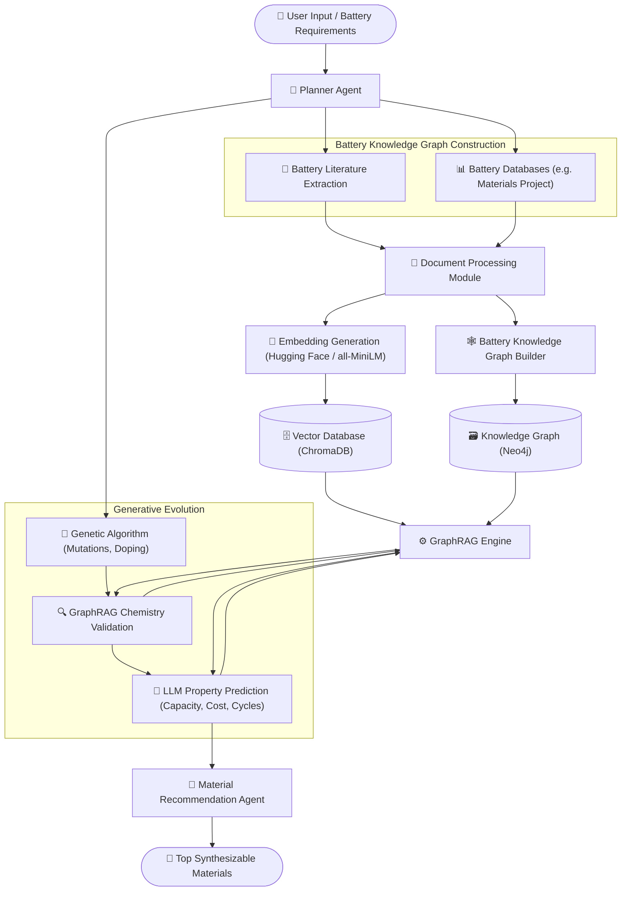

<h1 align="center">AURA: Autonomous Unified Research Assistant for Battery Materials Discovery</h1>

## Overview
AURA is an AI-powered, domain-specific research assistant designed to accelerate the discovery of new **Battery Materials**. Instead of a generic research assistant, AURA focuses on evolving and optimizing battery components (cathodes, anodes, electrolytes, SEI). It utilizes a multi-agent system powered by **GraphRAG**, **Genetic Algorithms (GA)**, and **LLM-based Property Prediction** to intelligently mutate known battery compositions, validate their feasibility, and predict their electrochemical properties before physical synthesis. 

## Technology Stack

  
  
  
  
  
  
  
  
  
  
  

## Detailed Architecture Flow

## Core Features & Logic Flow

### 1. Battery-Specific Knowledge Graph
AURA builds a comprehensive Knowledge Graph consisting of elements, battery materials (LCO, NMC, LFP), roles (Cathode, Anode, Electrolyte), degradation modes, and doping strategies.
* **Nodes:** Elements, Materials, Properties, Degradation Modes.
* **Edges:** `contains`, `can_be_doped_with`, `suffers_from`, `prevented_by`.

### 2. Battery-Specific GraphRAG Queries
Rather than generic similarity searches, AURA asks specific electrochemical questions:
* *Find cathode alternatives to LiCoO₂.*
* *What dopants improve cycling stability in Ni-rich cathodes?*
* *If I substitute Ni with Co, what happens to voltage and safety?*

### 3. Smart Genetic Algorithm (GA) Mutations
AURA uses GA to intelligently evolve battery compositions. Instead of random mutations, it applies chemistry-based rules and validates them instantly against the GraphRAG:
* **Element Substitution:** (e.g., replace Co with Ni).
* **Doping:** (e.g., add 10% Mg doping).
* **Validation:** Before accepting a mutation, GraphRAG checks if the structure remains stable, if the synthesis is realistic, and what the cost impact is.

### 4. LLM-Based Property Prediction
Instead of training a black-box ML model, AURA uses large language models (LLMs) equipped with GraphRAG context for highly interpretable property prediction.
* **Input:** New mutated composition (e.g., `LiNi₀.₇Co₀.₂Al₀.₁O₂`) + GraphRAG Context (similar materials, dopant effects).
* **Output:** Estimated specific capacity (mAh/g), voltage (V), cycle life, thermal stability, cost ($/kg), and **explainable reasoning** for the prediction.

### 5. Final Material Recommendation
After running multiple GA generations, materials are ranked by a fitness score (e.g., `Capacity × Cycles / Cost`). The system outputs a final structured report recommending the top novel materials that are actually worth synthesizing in the lab, complete with literature-backed evidence for their viability.

## Detailed Technology Stack

| Component | Technology | Description |
| :--- | :--- | :--- |
| **Frontend** | React, TailwindCSS | Provides a responsive, fast, and modern user interface for researchers to input requirements and view candidates. |
| **Backend API** | FastAPI | High-performance Python framework serving the core API and handling asynchronous multi-agent tasks. |
| **Task Queue** | Celery | Manages and distributes long-running Genetic Algorithm and LLM prediction tasks asynchronously. |
| **Message Broker** | Redis | In-memory data store acting as the message broker for Celery and caching intermediate GraphRAG results. |
| **Orchestration** | LangGraph | Manages the multi-agent workflows, state transitions, and the Genetic Algorithm (GA) execution loops. |
| **LLM Engine** | OpenRouter | Routes requests to top-tier LLMs (e.g., Claude, GPT) for deep chemical reasoning and property prediction. |
| **Knowledge Graph** | Neo4j | Graph database storing battery elements, materials, properties, and their complex electrochemical relationships. |
| **Vector Database** | ChromaDB | Lightweight, high-performance vector database for storing and retrieving context-aware text embeddings. |
| **Embeddings** | Hugging Face (`all-MiniLM`) | Generates semantic embeddings for battery research papers to power the GraphRAG retrieval engine. |