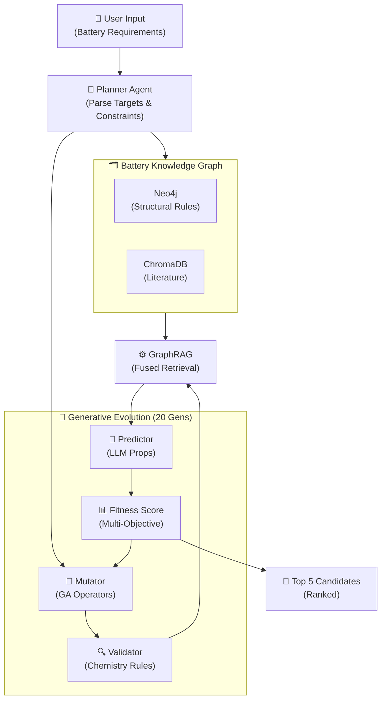
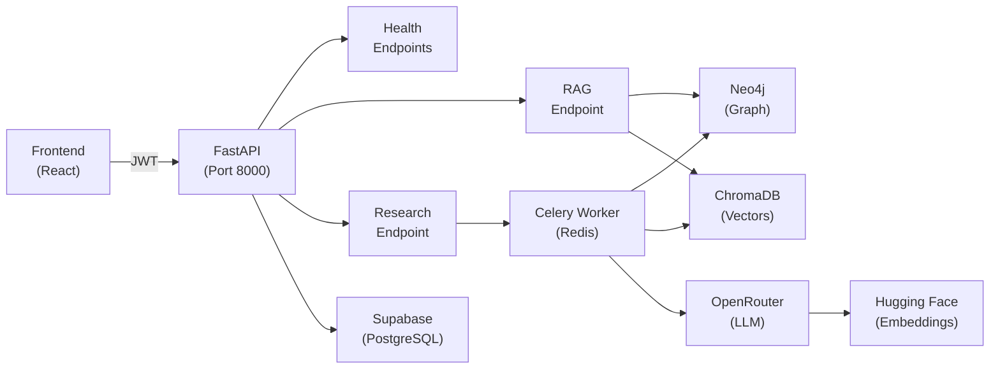
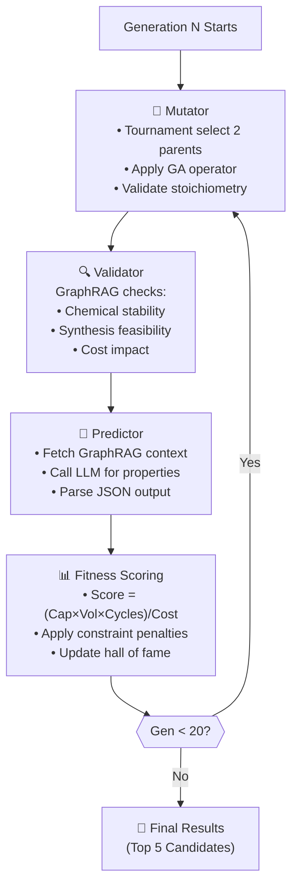

<h1 align="center">AURA: Autonomous Unified Research Assistant for Battery Materials Discovery</h1>

<p align="center">
  <em>AI-powered discovery of novel battery materials through intelligent multi-agent evolution, knowledge graphs, and LLM-based property prediction.</em>
</p>

---

## 📋 Overview

AURA is a domain-specific research assistant for accelerating battery material discovery. Instead of generic text generation, it intelligently evolves known battery compositions using:

- **Genetic Algorithm (GA)** for stoichiometrically-sound mutations
- **GraphRAG** for chemistry validation against literature and structural rules
- **LLM-based Property Prediction** for electrochemical property estimation
- **Multi-Agent Orchestration (LangGraph)** for seamless workflow coordination

**Key insight:** Evolution is guided by chemistry, not chance. Every mutated candidate respects valence rules, stoichiometry constraints, and real synthesis feasibility before being evaluated.

---

## 🛠 Technology Stack

<p align="center">
  
  
  
  
  
  
  
  
  
  
  
  
  
  
  
  
</p>

| Layer | Technology | Purpose |
|-------|-----------|---------|
| **Frontend** | React 19, Vite, TypeScript, TailwindCSS v4, Zustand | Modern interactive UI with state management |
| **Backend** | FastAPI, Python 3.12 | REST API and orchestration |
| **Async Tasks** | Celery + Redis | Long-running discovery tasks with progress tracking |
| **AI Orchestration** | LangGraph | Multi-agent workflow for discovery pipeline |
| **Auth & Data** | Supabase (PostgreSQL, Auth) | User management and task history |
| **Knowledge Graph** | Neo4j | Structural chemistry rules and relationships |
| **Vector DB** | ChromaDB (local persistent) | Battery literature embeddings |
| **LLM & Embeddings** | OpenRouter, Hugging Face (`all-MiniLM-L6-v2`) | Property prediction and semantic search |

---

## 🏗 System Architecture



### Component Architecture



---

## 📁 Project Structure

```
AURA_Data_Driven/
├── backend/                          # FastAPI + LangGraph engine
│   ├── app/
│   │   ├── core/                    # Config, auth, Celery setup
│   │   ├── db/                      # Supabase, Neo4j, ChromaDB clients
│   │   ├── api/v1/                  # REST endpoints
│   │   │   ├── endpoints/
│   │   │   │   ├── health.py       # DB health checks
│   │   │   │   ├── research.py     # Discovery task API
│   │   │   │   └── rag.py          # GraphRAG query endpoint
│   │   │   └── router.py
│   │   ├── agents/                  # LangGraph multi-agent pipeline
│   │   │   ├── state.py            # ResearchState schema
│   │   │   ├── workflow.py         # Graph wiring
│   │   │   └── nodes/
│   │   │       ├── planner.py      # Parse user requirements
│   │   │       ├── mutator.py      # Genetic Algorithm evolution
│   │   │       └── predictor.py    # LLM property prediction
│   │   ├── services/                # Business logic
│   │   │   ├── ga/                 # Genetic algorithm
│   │   │   │   ├── material.py     # Material stoichiometry
│   │   │   │   ├── operators.py    # Doping, substitution, crossover
│   │   │   │   ├── population.py   # Tournament selection
│   │   │   │   └── fitness.py      # Multi-objective scoring
│   │   │   ├── ingestion/          # Document processing
│   │   │   ├── retrieval/          # GraphRAG + vector search
│   │   │   ├── graph/              # Neo4j ingestion
│   │   │   ├── llm/                # OpenRouter client
│   │   │   └── embeddings.py       # Hugging Face embeddings
│   │   ├── models/                  # Pydantic schemas
│   │   └── scripts/                 # Setup & testing scripts
│   ├── worker/
│   │   └── tasks.py                # Celery task definitions
│   ├── tests/                       # pytest suite
│   ├── main.py                      # FastAPI app entry
│   ├── requirements.txt
│   ├── .env.example
│   └── docker-compose.yml           # Redis for local dev
│
├── frontend/                         # React + Vite UI
│   ├── src/
│   │   ├── pages/                  # Route pages
│   │   ├── components/             # Reusable UI components
│   │   ├── contexts/               # Auth context
│   │   ├── store/                  # Zustand research state
│   │   ├── lib/
│   │   │   ├── api.ts             # Axios + JWT interceptor
│   │   │   └── supabase.ts        # Supabase client
│   │   ├── App.tsx
│   │   └── main.tsx
│   ├── package.json
│   ├── tsconfig.json
│   ├── vite.config.ts
│   ├── eslint.config.js
│   └── .env.example
│
├── data/
│   └── seed_graph.json             # Ground-truth chemistry facts
│
├── docs/
│   ├── PRD.md                      # Product requirements
│   ├── TRD.md                      # Technical requirements
│   └── GA.md                       # Genetic algorithm design
│
├── phases/                          # Implementation roadmap
│   ├── phase_0.md                  # Scaffolding & setup
│   ├── phase_1.md                  # Document processing
│   ├── phase_2.md                  # Knowledge graph
│   ├── phase_3.md                  # GraphRAG engine
│   ├── phase_4.md                  # LangGraph setup
│   ├── phase_5.md                  # Genetic algorithm
│   ├── phase_6.md                  # LLM prediction
│   ├── phase_7.md                  # Evolution loop
│   └── phase_8.md                  # Results & reporting
│
├── CLAUDE.md                        # Developer guide & conventions
├── README.md                        # This file
└── LICENSE
```

---

## 🚀 Getting Started

### Prerequisites
- **Python 3.10+** (backend)
- **Node.js 18+** (frontend)
- **Docker** (Redis)
- **Environment variables** (see `.env.example` files)

### Backend Setup

```bash
cd backend
python -m venv .venv
source .venv/bin/activate  # On Windows: .venv\Scripts\activate

pip install -r requirements.txt
cp .env.example .env
# Edit .env with your API keys and database URLs

# Start Redis
docker compose up -d redis

# Run migrations (Neo4j constraints)
python -m app.db.neo4j_setup

# Seed ground-truth chemistry data
python -m app.scripts.seed_neo4j

# Start API server
uvicorn main:app --reload --port 8000

# In another terminal, start Celery worker
celery -A app.core.celery_app worker --loglevel=info
```

### Frontend Setup

```bash
cd frontend
npm install
cp .env.example .env
# Edit .env with backend URL and Supabase keys

npm run dev          # Start dev server (http://localhost:5173)
npm run build        # Production build
npm run lint         # TypeScript + ESLint checks
```

### Verify Setup
- **API Health:** `curl http://localhost:8000/health`
- **DB Health:** `curl http://localhost:8000/health/db`
- **Test Celery:** `curl -X POST http://localhost:8000/test-celery?iterations=3`

---

## 📡 API Endpoints

| Method | Endpoint | Purpose |
|--------|----------|---------|
| `GET` | `/health` | Basic API health |
| `GET` | `/health/db` | Database connectivity status |
| `POST` | `/test-celery` | Trigger test Celery task |
| `GET` | `/task/{task_id}` | Poll Celery task status |
| **Research API** |
| `POST` | `/api/v1/research/start` | Initiate discovery task (requires JWT) |
| `GET` | `/api/v1/research/status/{task_id}` | Poll task progress |
| **RAG API** |
| `POST` | `/api/v1/rag/query` | Query GraphRAG for battery chemistry context |

### Example: Discover a Cathode

```bash
# 1. Start discovery task
curl -X POST http://localhost:8000/api/v1/research/start \
  -H "Authorization: Bearer YOUR_JWT" \
  -H "Content-Type: application/json" \
  -d '{"prompt": "Find a cathode with >280 mAh/g capacity, <50$/kg, without Cobalt"}'

# Response: { "task_id": "abc-123", "status": "started" }

# 2. Poll progress
curl http://localhost:8000/api/v1/research/status/abc-123

# Response: { "status": "Completed Generation 5...", "generation": 5, "best_score": 450.2 }

# 3. Retrieve results
curl http://localhost:8000/api/v1/research/status/abc-123
# When state == "Complete", the response includes "results": [...]
```

---

## 🗄 Database Schemas

### Supabase (PostgreSQL)
- **Users:** Managed by Supabase Auth
- **ResearchTasks:** `(id, user_id, prompt, status, created_at, result_json)`
- **SavedMaterials:** `(id, user_id, composition, predicted_capacity, cost, reasoning)`
- **ChatMessages:** `(id, user_id, role, content, created_at)`

### Neo4j (Knowledge Graph)

**Nodes:**
- `Element`: Li, Ni, Co, Mn, Mg, Al, O, etc.
- `Material`: LCO, NMC811, LFP, LMO, Graphite, etc.
- `Property`: High Capacity, Low Cost, Thermal Stability, etc.
- `DegradationMode`: Cation Mixing, Microcracking, Oxygen Release, etc.

**Edges:**
- `(Material)-[:CONTAINS]->(Element)`
- `(Material)-[:CAN_BE_DOPED_WITH]->(Element)`
- `(Material)-[:SUFFERS_FROM]->(DegradationMode)`
- `(Element)-[:MITIGATES]->(DegradationMode)`
- `(Element)-[:INCREASES|DECREASES]->(Property)`

### ChromaDB (Vector Store)
- **Collections:**
  - `battery_literature`: Chunked research paper embeddings (384-dim, `all-MiniLM-L6-v2`)
  - `material_properties`: Property descriptions and synthesis data

---

## 🔄 Discovery Workflow (20 Generations)



---

## 🧪 Testing

```bash
cd backend
pytest                    # Run all tests
pytest -v               # Verbose output
pytest tests/test_ga_phase5.py -k "material"  # Specific test

# Coverage
pytest --cov=app --cov-report=html
```

**Test coverage:**
- GA material parser and stoichiometry validation
- GA operators (doping, substitution, crossover) and constraints
- GraphRAG entity extraction and fallbacks
- Fitness scoring and constraint penalties
- LLM client retry logic and error handling

---

## 🛡 GA Invariants (Must Maintain)

The Genetic Algorithm enforces strict chemistry constraints:

1. **Transition Metal Sum = 1.0** (in octahedral sites)
   - No element can have negative coefficient
   - Mutations preserve this by proportional redistribution

2. **Lithium & Oxygen Stoichiometry Fixed**
   - Only transition metals/dopants are mutated
   - Base lattice remains stable

3. **Canonical Representation**
   - Li first, metals alphabetical, O last
   - Prevents duplicate candidates from appearing different

4. **Excluded Elements Respected**
   - User-excluded elements never enter population
   - Verified after every mutation

5. **Elitism**
   - Top 2 materials auto-carry to next generation unchanged
   - Guarantees monotonic improvement

---

## 🔐 Security & Configuration

### Environment Variables

**Backend** (`.env`)
```
SUPABASE_URL=<your-supabase-url>
SUPABASE_SERVICE_ROLE_KEY=<service-role-key>
SUPABASE_JWT_SECRET=<jwt-secret>
NEO4J_URI=bolt://localhost:7687
NEO4J_USERNAME=neo4j
NEO4J_PASSWORD=<password>
REDIS_URL=redis://localhost:6379/0
OPENROUTER_API_KEY=<key>
GEMINI_API_KEY=<key>
HF_API_key=<key>
```

**Frontend** (`.env`)
```
VITE_SUPABASE_URL=<url>
VITE_SUPABASE_ANON_KEY=<anon-key>
VITE_API_DEV_URL=http://localhost:8000
VITE_API_PRO_URL=https://your-deployed-api.com
VITE_MODE=development
```

### Best Practices
- **Never** commit `.env` files
- **Rotate** API keys regularly
- **Use** environment-specific keys (dev vs. prod)
- **Restrict** CORS to known frontend domains
- **Validate** all user input server-side

---

## 📊 Implementation Status

| Phase | Component | Status |
|-------|-----------|--------|
| 0 | Backend scaffolding, FastAPI, databases, JWT auth | ✅ Complete |
| 1 | Document ingestion, embeddings, ChromaDB persistence | ✅ Complete |
| 2 | Knowledge graph, Neo4j constraints, seed data | ✅ Complete |
| 3 | GraphRAG fusion, entity extraction, fallbacks | ✅ Complete |
| 4 | LangGraph multi-agent workflow, state management | ✅ Complete |
| 5 | GA operators (doping, substitution, crossover), constraints | ✅ Complete |
| 6 | LLM prediction (OpenRouter + Gemini), async retries | ✅ Complete |
| 7 | Evolution loop (20 gens), Celery tasks, fitness scoring | ✅ Complete |
| 8 | Results reporting, PDF export, frontend dashboard | ❌ Not Started |

**Notes:**
- Phase 0-7 fully implemented with fixes for async, GA constraints, API auth, and LLM resilience
- Phase 8 (results page) requires frontend research form and results visualization
- Backend tests: 9/9 passing
- Frontend lint/build: both passing without errors

---

<p align="center">
  <strong>Made with ❤️ for battery material scientists</strong>
  <br/>
  <em>Accelerating discovery, one generation at a time.</em>
</p>
