<div align="center">

# AURA

### Autonomous Unified Research Assistant for Battery Materials Discovery

*Chemistry-constrained evolution, GraphRAG validation and LLM property prediction, orchestrated end to end by a multi-agent pipeline.*

<br/>


<br/>

[Overview](#overview) ·
[Architecture](#architecture) ·
[Pipeline](#multi-agent-pipeline) ·
[Quick start](#quick-start) ·
[API](#api-reference) ·
[Configuration](#configuration-reference) ·
[Testing](#testing) ·
[Troubleshooting](#troubleshooting)

</div>

<br/>

---

## Table of contents

1. [Overview](#overview)
2. [Technology stack](#technology-stack)
3. [Architecture](#architecture)
4. [Multi-agent pipeline](#multi-agent-pipeline)
5. [Genetic algorithm](#genetic-algorithm)
6. [GraphRAG and ingestion](#graphrag-and-ingestion)
7. [LLM layer, quota and call budget](#llm-layer-quota-and-call-budget)
8. [Data layer](#data-layer)
9. [Frontend](#frontend)
10. [Security](#security)
11. [Quick start](#quick-start)
12. [API reference](#api-reference)
13. [Configuration reference](#configuration-reference)
14. [Testing](#testing)
15. [Production deployment](#production-deployment)
16. [Project structure](#project-structure)
17. [Troubleshooting](#troubleshooting)
18. [Known limitations](#known-limitations)
19. [Implementation status](#implementation-status)
20. [Documentation, contributing and license](#documentation-contributing-and-license)

---

## Overview

AURA accelerates battery material discovery. A researcher describes a target in plain language, for example *"a cobalt-free cathode with more than 250 mAh/g and under $50/kg"*, and AURA runs an automated search that evolves real cathode compositions toward that target.

Instead of free-form text generation, **chemistry decides what is allowed**:

| Concern | How AURA handles it |
|---|---|
| Which candidates exist | A deterministic **genetic algorithm** mutates known layered oxides through doping, substitution and crossover |
| Is a candidate chemically sane | Stoichiometry is enforced in code (transition metals always sum to 1.0), then **GraphRAG** checks it against a Neo4j rule graph and literature |
| How good is it | An **LLM** predicts capacity, voltage, cycle life and cost from retrieved context, and a multi-objective **fitness** function ranks the result |
| What does the user get | An LLM-written **executive summary**, top-5 material cards with radar charts, an evolution chart, an interactive **knowledge graph** and a one-click **PDF** |

> **Key principle:** the LLM never invents chemistry rules. The GA and GraphRAG define the search space; the LLM only estimates properties inside it.

### Capabilities

- **Natural-language planning**: the planner extracts numeric targets, material class and excluded elements from free text.
- **Constraint-safe evolution**: 20 generations of elitist GA with tournament selection and canonical formula deduplication.
- **Hybrid retrieval**: Neo4j structural rules and ChromaDB literature fetched concurrently and fused.
- **Quota-aware LLM usage**: batched prediction and validation cut a full run from about 2,300 requests to about 42, and a spent quota fails the run loudly instead of producing garbage.
- **Asynchronous by design**: long runs execute in Celery, the UI polls progress and redirects to results on completion.
- **Persistent history**: every run and its top candidates are stored per user in Supabase under row level security.

---

## Technology stack

<div align="center">

**Frontend**


**Backend and orchestration**


**Data and infrastructure**


**AI**


</div>

| Layer | Technology | Role in AURA |
|---|---|---|
| UI | React 19, Vite 8, TypeScript (strict), Tailwind CSS v4 | Single-page app, build tooling, styling |
| UI state and forms | Zustand, React Context, React Hook Form, Zod | Research task state, auth session, validated forms |
| Routing | React Router v7 | Public pages and protected dashboard and results routes |
| Visualization | Recharts, `react-force-graph-2d` | Radar and evolution charts, interactive chemistry graph |
| Motion and export | Framer Motion, Lenis, `jspdf`, `html2canvas` | Scroll and stagger animation, smooth scroll, client-side PDF report |
| API | FastAPI, Uvicorn, Pydantic v2 | REST endpoints, request validation, ASGI server |
| Orchestration | LangGraph | planner, mutator, predictor, reporter workflow graph |
| Async execution | Celery with Upstash Redis (TLS) | Long-running discovery tasks and progress polling |
| Identity and relational data | Supabase (Auth and PostgreSQL) | JWT auth, `ResearchTasks`, `SavedMaterials`, `chat_messages` |
| Knowledge graph | Neo4j (Aura or local) | Structural chemistry rules |
| Vector store | ChromaDB (local persistent) | Literature embeddings |
| Embeddings | ChromaDB `DefaultEmbeddingFunction` (local ONNX `all-MiniLM-L6-v2`, 384-dim) | Offline semantic embeddings, no external embedding call |
| LLM | OpenRouter free router, Gemini 2.5 Flash fallback | Planning, prediction, validation, summarization |
| Ingestion | PyMuPDF, `langchain-text-splitters` | PDF parsing and chunking |
| Resilience | `tenacity` | Retry with exponential backoff |
| Quality | Pytest, `pytest-asyncio`, ESLint, `tsc` | Backend unit tests, frontend lint and type-check |

---

## Architecture

### System context

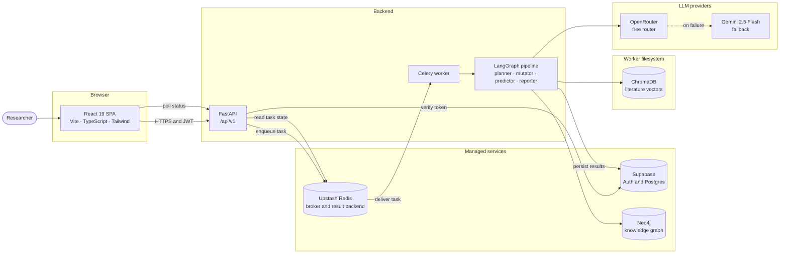

### Runtime topology

Three local processes talk to four managed services. No Docker and no local Redis are required.

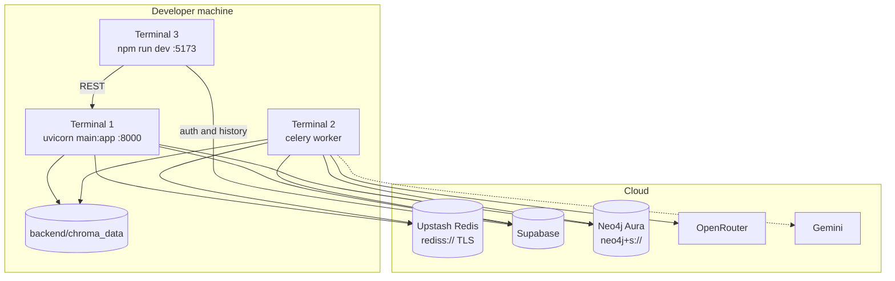

### End-to-end request lifecycle

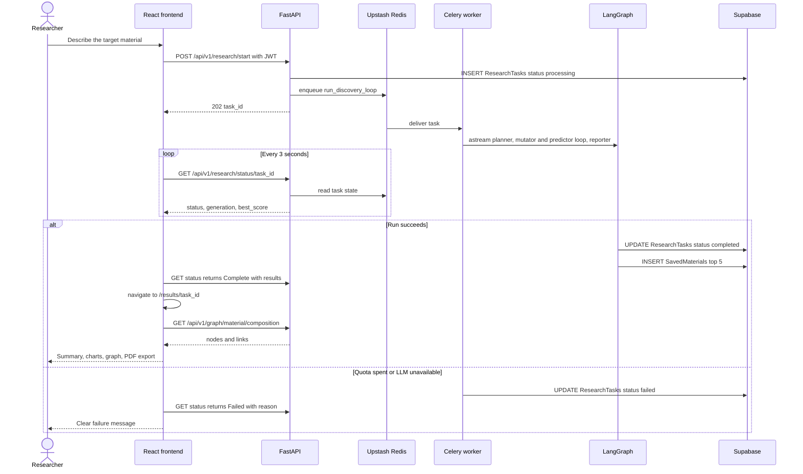

### Task state mapping

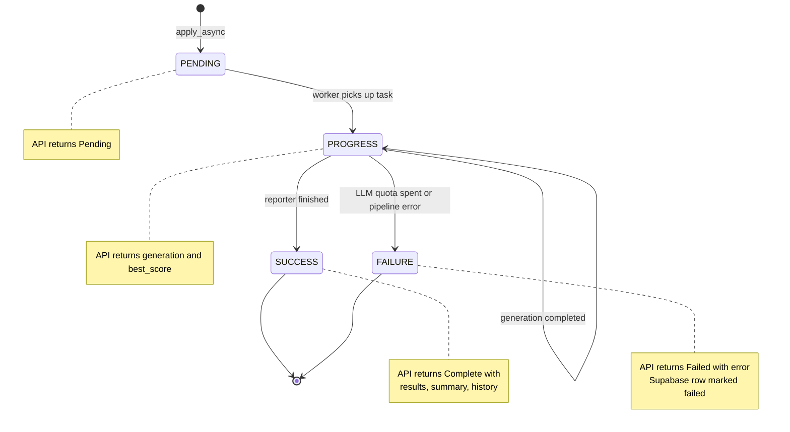

---

## Multi-agent pipeline

The pipeline is a LangGraph state machine over a shared `ResearchState`.

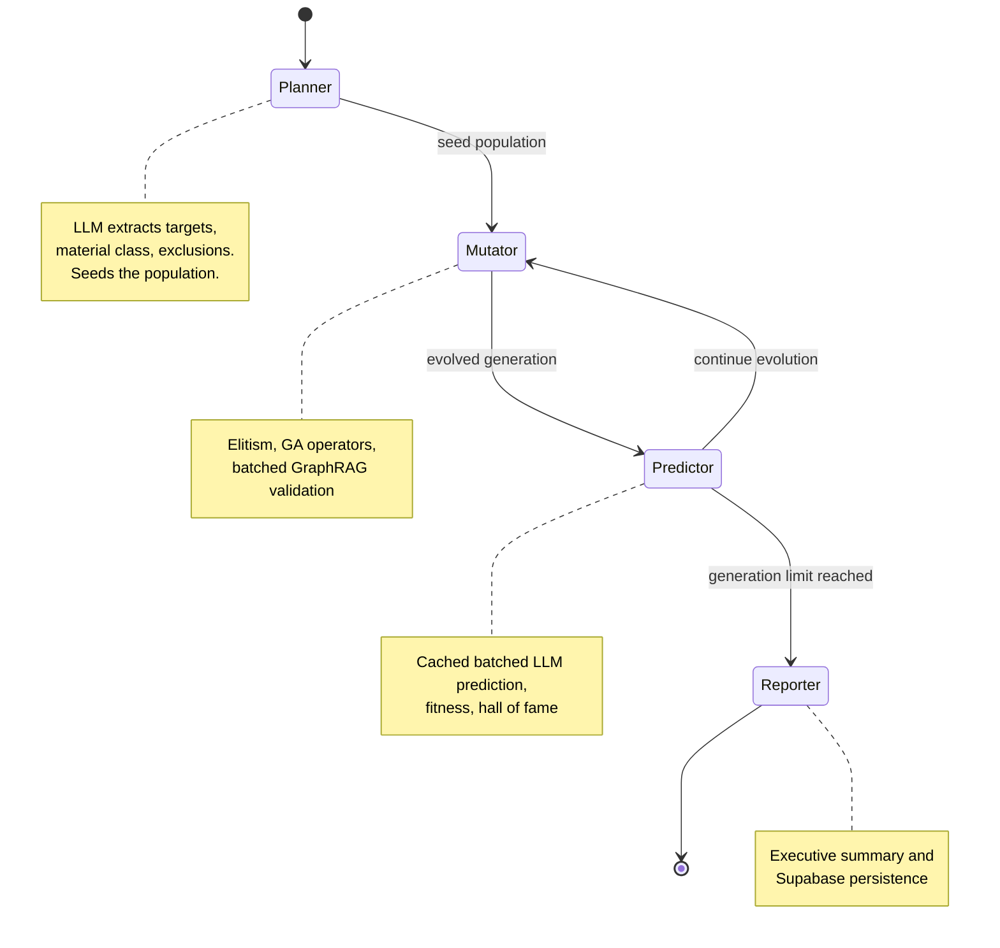

| Node | Responsibility | LLM calls |
|---|---|---|
| **Planner** | Parse the prompt into `target_properties`, `base_material_class` and `excluded_elements`. Seed the population from baseline layered oxides, skipping excluded elements. | 1 |
| **Mutator** | Keep 2 elites, draw a pool of children via doping, substitution and crossover, validate the pool in one batch, fill the next generation. | 1 per generation |
| **Predictor** | Predict properties for compositions not yet cached in one batch, score fitness, update the top-5 hall of fame and generation history. | 1 per generation |
| **Reporter** | Write the 3-paragraph executive summary, persist the task result and top candidates. Falls back to a canned summary if the LLM fails. | 1 |

### One generation in detail

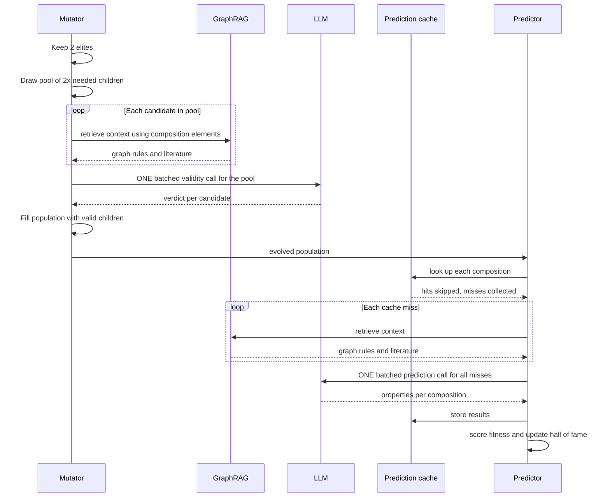

---

## Genetic algorithm

Operators are deterministic code. The LLM is never asked to propose compositions.


### Invariants

1. **Transition-metal sum is exactly 1.0.** Mutations redistribute proportionally and abort rather than produce a negative coefficient.
2. **Lithium and oxygen stoichiometry is fixed.** Only metals and dopants mutate.
3. **Canonical representation.** Li first, metals alphabetical, O last, so identical compounds never look different.
4. **Excluded elements never enter a genome.**
5. **Elitism.** The top 2 candidates carry into the next generation unchanged.

### Fitness

```text
base    = (specific_capacity × voltage × cycle_life) / cost_usd_per_kg
penalty = 0.2 for each violated target  (capacity_gt, voltage_gt, cycle_life_gt, cost_lt)
fitness = base × penalty
```

Population sizing is configurable (see [Configuration reference](#configuration-reference)). Defaults: 10 seeds, 20 candidates per generation, 20 generations.

---

## GraphRAG and ingestion

### Retrieval

Graph rules and literature are fetched concurrently and fused into one context.


The GA nodes pass element symbols parsed from the composition, which removes the LLM entity-extraction call that previously ran on every retrieval. Only the chat endpoint still uses LLM extraction.

### Knowledge ingestion

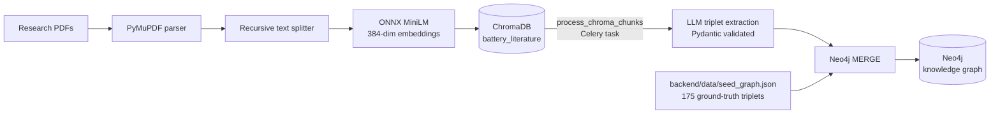

---

## LLM layer, quota and call budget

### Provider strategy

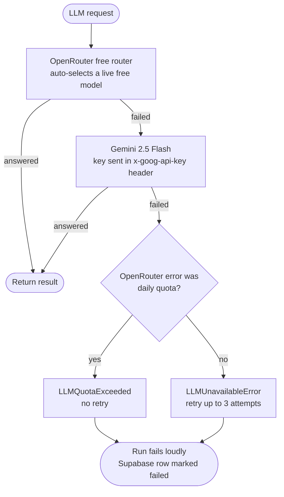

- **No silent degradation.** A prediction that cannot be made fails the run. It is never scored as zero.
- **Quota errors are not retried.** Neither tenacity nor the OpenAI SDK retries a spent daily quota.
- **Secrets stay out of errors.** Gemini failures are reported by HTTP status only.

### Request budget for a 20-generation run

Measured with the offline simulator (`app/scripts/simulate_discovery_run.py`):

| | Before | After |
|---|---|---|
| LLM requests per run | about 2,300 | **about 42** |
| Entity extraction | LLM call on every retrieval | none in the GA loop |
| Property prediction | one call per material per generation | one batch per generation, plus a cache |
| Validation | one call per child | one batch per generation |

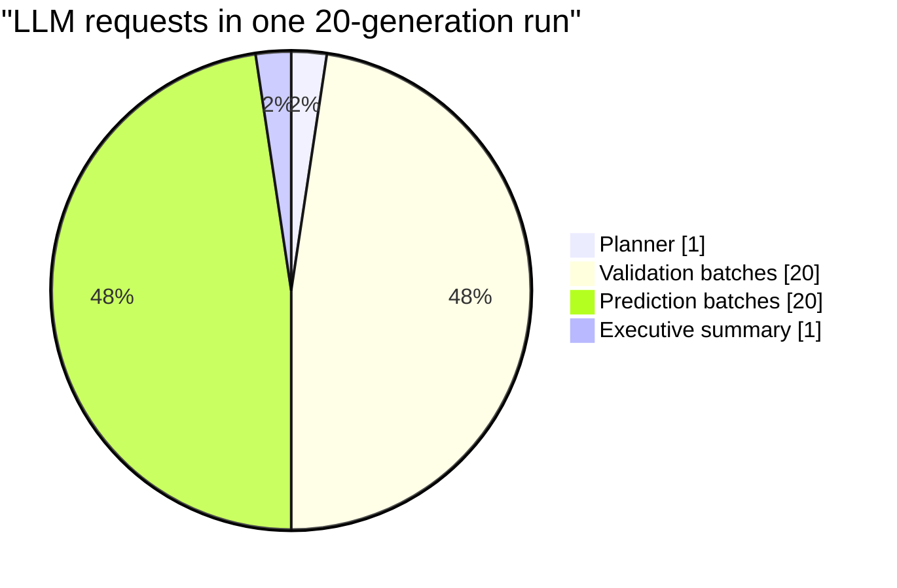

The OpenRouter free tier allows 50 requests per day, so one full run fits. Use `GA_GENERATIONS=3` for cheap test runs.

---

## Data layer

### Supabase (PostgreSQL)

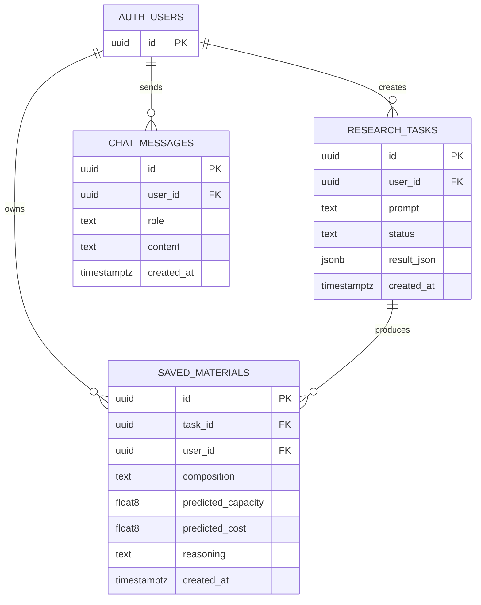

- Create everything by running [`backend/supabase/schema.sql`](backend/supabase/schema.sql) once in the Supabase SQL editor. It is idempotent.
- **Row level security is on for every table.** Policies scope reads to `auth.uid() = user_id` (plus inserts on `ResearchTasks` and `chat_messages`, and deletes on `chat_messages`).
- The backend uses the **service role key**, which bypasses RLS. The frontend uses the **anon key**, which respects it.
- `ResearchTasks.status` moves `processing` to `completed` or `failed`. On failure `result_json` holds the reason.

### Neo4j knowledge graph

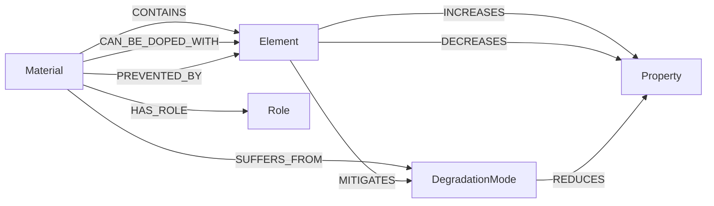

- Seeded from 175 triplets in [`backend/data/seed_graph.json`](backend/data/seed_graph.json), extended at runtime by literature extraction (which also adds `EXHIBITS`).
- Uniqueness constraints on `Element.symbol`, `Material.name`, `Property.name` and `DegradationMode.name` are created on API startup.
- The driver recycles pooled connections every 300 seconds to stay ahead of Aura's idle timeout.

### ChromaDB

- Collections: `battery_literature` (chunked paper text) and `material_properties`.
- Persisted under `backend/chroma_data/` (configurable). It is git-ignored, and both the API and the worker read it from disk.

---

## Frontend

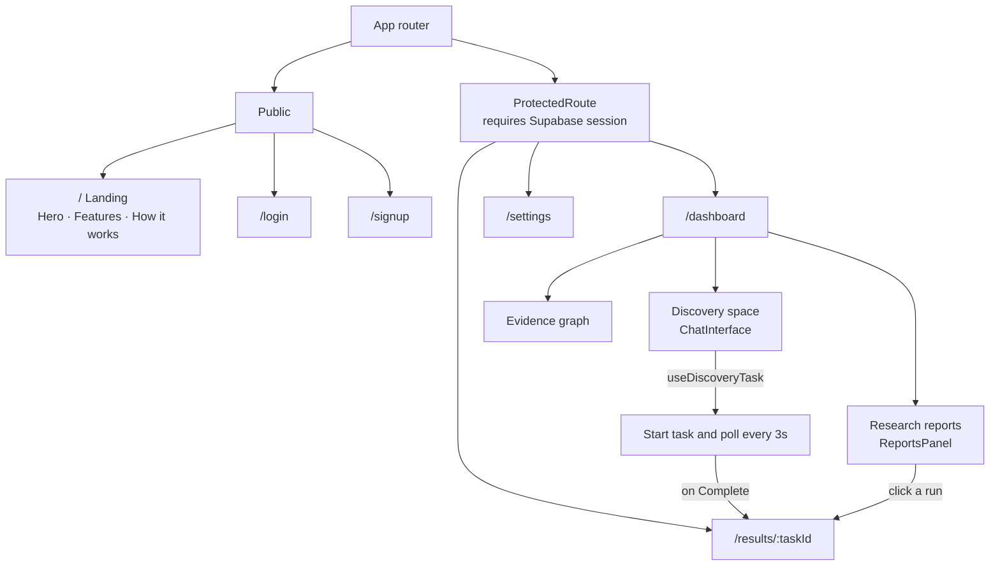

### Results dashboard

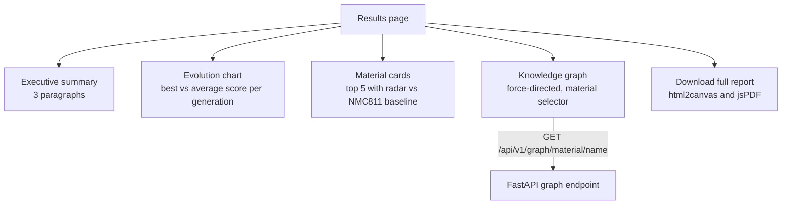

- Knowledge graph colors: **gold** Material, **blue** Element, **green** Property, **red** DegradationMode.
- Sections animate in with Framer Motion stagger effects and Lenis smooth scrolling.
- State lives in Zustand (`useResearchStore`) and an auth context backed by the Supabase session.

---

## Security

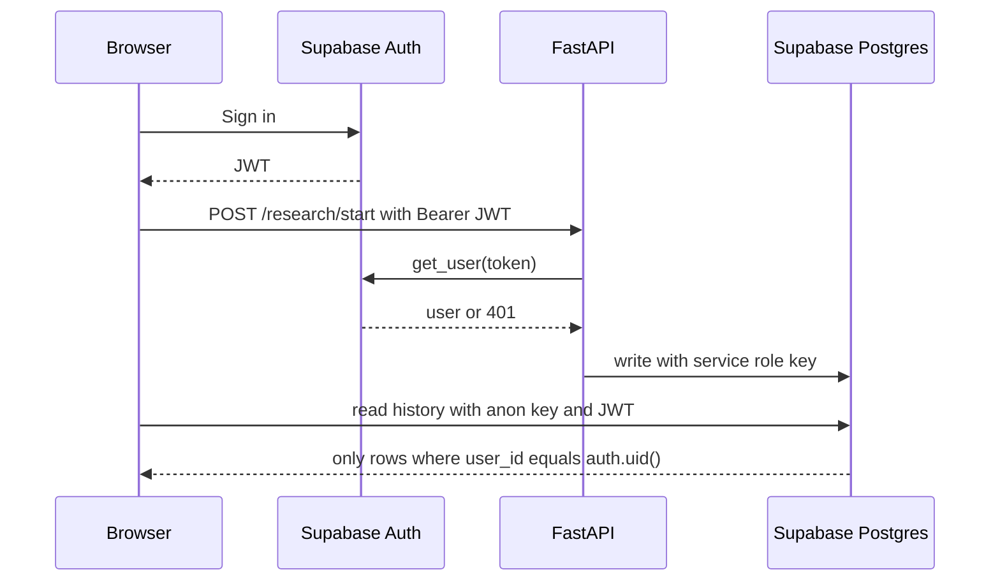

| Area | Practice |
|---|---|
| Authentication | `POST /api/v1/research/start` requires a valid Supabase JWT, verified server-side |
| Authorization | Row level security on every table, scoped to `auth.uid()` |
| Secrets | Backend `.env` only. Service role key, LLM keys and database credentials never reach the browser |
| API keys in transit | Gemini key travels in the `x-goog-api-key` header, never in a URL, so it cannot leak through logs or stored errors |
| Failure messages | Stored failure reasons contain no exception text for unexpected errors |
| CORS | Allow-listed to the local Vite origin. Add your production origin in `backend/main.py` before deploying |
| Input validation | Pydantic schemas on every endpoint |

---

## Quick start

> **No Docker and no local Redis or Neo4j install needed.** AURA runs against managed Upstash Redis, Supabase and Neo4j Aura.

### Prerequisites

| Requirement | Notes |
|---|---|
| Python 3.12 | Backend |
| Node.js 20+ | Frontend |
| Supabase project | Auth and Postgres. Free tier is fine |
| Upstash Redis database | Celery broker and result backend. Copy the `rediss://` connection string |
| Neo4j | AuraDB free instance (`neo4j+s://...`) or a local server |
| OpenRouter API key | Primary LLM. Free tier allows 50 requests per day |
| Gemini API key | Fallback LLM |

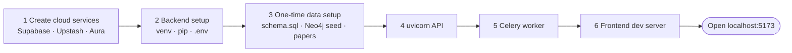

### 1. Backend setup

```bash
cd backend
python3.12 -m venv .venv
source .venv/bin/activate          # Windows: .venv\Scripts\activate
pip install -r requirements.txt
cp .env.example .env               # then fill it in (see below)
```

Backend `.env`:

```dotenv
# Supabase
SUPABASE_URL=https://<project>.supabase.co
SUPABASE_SERVICE_ROLE_KEY=<service-role-key>
SUPABASE_JWT_SECRET=<jwt-secret>

# Upstash Redis (TLS). Use the plain rediss:// URL with NO query parameters.
REDIS_URL=rediss://default:<password>@<name>.upstash.io:6379

# Neo4j (Aura shown; local is bolt://localhost:7687)
NEO4J_URI=neo4j+s://<id>.databases.neo4j.io
NEO4J_USERNAME=neo4j
NEO4J_PASSWORD=<password>

# LLMs
OPENROUTER_API_KEY=<key>
GEMINI_API_KEY=<key>
HF_API_key=<key>

# ChromaDB
CHROMA_DATABASE=<name>
CHROMA_PERSIST_DIRECTORY=./chroma_data
```

> TLS for `rediss://` is configured in code (`backend/app/core/celery_app.py`). Do **not** append `?ssl_cert_reqs=...` to the URL.

### 2. One-time data setup

```bash
# a) Supabase: open the SQL editor and run backend/supabase/schema.sql once.
#    It creates ResearchTasks, SavedMaterials, chat_messages and their RLS policies.

# b) Seed the Neo4j knowledge graph (from backend/, venv active)
python -m app.scripts.seed_neo4j

# c) Optional: ingest literature into ChromaDB.
#    Unzip data/raw/papers.zip into a folder of PDFs, then:
python -m app.scripts.ingest_papers --dir data/raw/papers
```

Neo4j uniqueness constraints are created automatically when the API starts.

### 3. Run the three processes

Open three terminals.

```bash
# Terminal 1: API (from backend/, venv active)
uvicorn main:app --reload --port 8000
# Docs at http://localhost:8000/docs
```

```bash
# Terminal 2: Celery worker (from backend/, venv active)
celery -A app.core.celery_app.celery_app worker --loglevel=info
```

```bash
# Terminal 3: Frontend (from frontend/)
npm install
cp .env.example .env               # set VITE_SUPABASE_URL, VITE_SUPABASE_ANON_KEY, VITE_API_DEV_URL
npm run dev                        # http://localhost:5173
```

Frontend `.env`:

```dotenv
VITE_API_DEV_URL=http://127.0.0.1:8000
VITE_API_PRO_URL=https://<your-deployed-api>
VITE_MODE=development
VITE_SUPABASE_URL=https://<project>.supabase.co
VITE_SUPABASE_ANON_KEY=<anon-key>
```

| Terminal | Command | Directory |
|---|---|---|
| 1 | `uvicorn main:app --reload --port 8000` | `backend/` |
| 2 | `celery -A app.core.celery_app.celery_app worker --loglevel=info` | `backend/` |
| 3 | `npm run dev` | `frontend/` |

On macOS the worker automatically uses Celery's `solo` pool (the default `prefork` pool crashes under macOS `spawn`). Linux keeps `prefork`.

### 4. Verify

```bash
curl http://localhost:8000/api/v1/health
curl http://localhost:8000/api/v1/health/db          # neo4j, chroma, supabase
curl -X POST "http://localhost:8000/api/v1/test-celery?iterations=3"
```

For a first real run, set `GA_GENERATIONS=3` in `backend/.env`. It uses about 8 LLM requests instead of 42.

---

## API reference

All routes are mounted under `/api/v1`.

| Method | Endpoint | Auth | Purpose |
|---|---|---|---|
| `GET` | `/health` | none | Liveness |
| `GET` | `/health/db` | none | Neo4j, ChromaDB and Supabase connectivity |
| `POST` | `/test-celery` | none | Queue a dummy Celery task |
| `GET` | `/task/{task_id}` | none | Raw Celery task state |
| `POST` | `/research/start` | **JWT** | Start a discovery task. Body `{ "prompt": "..." }` |
| `GET` | `/research/status/{task_id}` | none | Progress, final report or failure reason |
| `POST` | `/rag/query` | none | GraphRAG answer for a chemistry question |
| `GET` | `/graph/material/{material_name}` | none | `{ nodes, links }` graph for a formula |

### Status response shapes

| State | Response |
|---|---|
| Pending | `{ "status": "Pending...", "generation": 0, "best_score": 0.0 }` |
| In progress | `{ "status": "Completed Generation 5...", "generation": 5, "best_score": 450.2 }` |
| Complete | `{ "status": "Complete", "generation", "best_score", "results": [...], "executive_summary", "generation_history": [...] }` |
| Failed | `{ "status": "Failed", "error": "..." }` |

### Example

```bash
# 1. Start a discovery task
curl -X POST http://localhost:8000/api/v1/research/start \
  -H "Authorization: Bearer $JWT" \
  -H "Content-Type: application/json" \
  -d '{"prompt": "Find a cathode with >280 mAh/g capacity, <50$/kg, without Cobalt"}'
# { "task_id": "abc-123", "status": "started" }

# 2. Poll
curl http://localhost:8000/api/v1/research/status/abc-123

# 3. Explore the chemistry behind a top candidate
curl "http://localhost:8000/api/v1/graph/material/LiNi0.5Mn0.5O2"
# { "nodes": [...], "links": [...] }
```

---

## Configuration reference

### Backend

| Variable | Required | Default | Purpose |
|---|---|---|---|
| `SUPABASE_URL` | yes | | Supabase project URL |
| `SUPABASE_SERVICE_ROLE_KEY` | yes | | Backend writes, bypasses RLS |
| `SUPABASE_JWT_SECRET` | yes | | JWT secret |
| `REDIS_URL` | yes | | Upstash `rediss://...` connection string |
| `NEO4J_URI` / `NEO4J_USERNAME` / `NEO4J_PASSWORD` | yes | | Neo4j connection |
| `OPENROUTER_API_KEY` | recommended | none | Primary LLM. Without it AURA uses Gemini only |
| `GEMINI_API_KEY` | yes | | Fallback LLM |
| `HF_API_key` | yes | | Required by settings validation |
| `CHROMA_DATABASE` | yes | | Chroma database name |
| `CHROMA_PERSIST_DIRECTORY` | no | `./chroma_data` | Vector store location |
| `GA_GENERATIONS` | no | `20` | Generations per run |
| `GA_SEED_POPULATION` | no | `10` | Initial population size |
| `GA_POPULATION_SIZE` | no | `20` | Candidates per generation |
| `DATABASE_URL` | no | | Only for the legacy `setup_chat_table.py` script |

### Frontend

| Variable | Purpose |
|---|---|
| `VITE_API_DEV_URL` / `VITE_API_PRO_URL` | API base URL for development and production |
| `VITE_MODE` | `development` or `production` |
| `VITE_SUPABASE_URL` / `VITE_SUPABASE_ANON_KEY` | Public Supabase credentials |

---

## Testing

```bash
cd backend
source .venv/bin/activate
pytest tests                         # 32 unit tests
pytest tests -v
pytest tests/test_quota_failfast.py -v
```

> Run `pytest tests`, not bare `pytest`. The scripts under `app/scripts/` named `test_*.py` are manual live checks that call real services.

| Suite | Covers |
|---|---|
| `test_ga_phase5.py` | Formula parser, doping, substitution, excluded elements, mutator diversity |
| `test_fitness_phase7.py` | Fitness scoring and constraint penalties |
| `test_graphrag_unit.py` | GraphRAG fusion and fallbacks |
| `test_composition_entities.py` | Composition-derived entities skip LLM extraction |
| `test_batch_prediction.py` | One batch per generation, prediction cache, missing-item retry |
| `test_batch_validation.py` | Pool validation, verdict cache, bounded top-up |
| `test_quota_failfast.py` | Quota errors not retried, run marked failed, no key in messages |
| `test_ga_settings.py` | Configurable generations and population |
| `test_gemini_key_header.py` | Gemini key sent in header, never in a URL |
| `test_reporter_phase8.py` | Reporter summary and persistence, material graph construction |

### Simulating a run without spending quota

The simulator runs the real LangGraph pipeline against a fake LLM and counts requests:

```bash
cd backend
python -m app.scripts.simulate_discovery_run --generations 20     # offline, no network
python -m app.scripts.simulate_discovery_run --generations 2 --live   # real services, spends quota
```

### Frontend

```bash
cd frontend
npm run lint      # ESLint with strict TypeScript and react-hooks rules
npm run build     # tsc -b and vite build
```

---

## Production deployment

AURA is split so each tier scales independently.

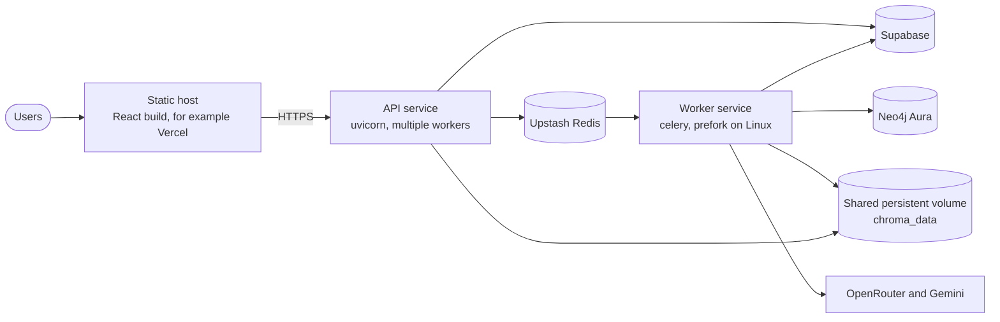

| Checklist item | Detail |
|---|---|
| Frontend build | `npm run build`, serve `frontend/dist`, set `VITE_API_PRO_URL` and `VITE_MODE=production` |
| API | `uvicorn main:app --host 0.0.0.0 --port $PORT` behind HTTPS |
| Worker | `celery -A app.core.celery_app.celery_app worker --loglevel=info --concurrency N`. Linux uses `prefork` |
| CORS | Add the production frontend origin to `allow_origins` in `backend/main.py` |
| Vector store | API and worker both read `chroma_data`. Mount the same persistent volume, or move to a hosted Chroma |
| LLM capacity | Free tier is 50 requests per day, about one full run. Add OpenRouter credit for sustained use |
| Secrets | Inject environment variables from your platform. Never commit `.env` |
| Health checks | Probe `/api/v1/health` and `/api/v1/health/db` |

---

## Project structure

```text
AURA_Data_Driven/
├── backend/
│   ├── app/
│   │   ├── core/                   # config, JWT auth, Celery app
│   │   ├── db/                     # Supabase, Neo4j, ChromaDB clients, Neo4j constraints
│   │   ├── api/v1/
│   │   │   ├── endpoints/          # health, research, rag, graph
│   │   │   └── router.py
│   │   ├── agents/
│   │   │   ├── state.py            # ResearchState
│   │   │   ├── workflow.py         # LangGraph wiring
│   │   │   └── nodes/              # planner, mutator, predictor, reporter
│   │   ├── services/
│   │   │   ├── ga/                 # material, operators, population, fitness
│   │   │   ├── ingestion/          # PDF parser, chunker, upsert
│   │   │   ├── retrieval/          # vector, graph, GraphRAG fusion
│   │   │   ├── graph/              # triplet extraction and Neo4j ingestion
│   │   │   ├── llm/                # client (batch predict, validate, summarize) and errors
│   │   │   └── embeddings.py       # local ONNX embedding function
│   │   ├── models/                 # Pydantic schemas
│   │   └── scripts/                # seeding, ingestion, simulator, manual checks
│   ├── worker/tasks.py             # Celery tasks
│   ├── data/                       # seed_graph.json, raw/papers.zip
│   ├── supabase/schema.sql         # tables and RLS policies
│   ├── tests/                      # 32 pytest tests
│   ├── main.py                     # FastAPI app, lifespan, CORS
│   ├── requirements.txt
│   └── .env.example
├── frontend/
│   └── src/
│       ├── pages/                  # Landing, Login, Signup, Dashboard, Results, Settings
│       ├── components/             # landing, dashboard, results, shared
│       ├── contexts/               # auth context
│       ├── hooks/useDiscoveryTask.ts
│       ├── store/                  # Zustand research store
│       ├── lib/                    # api, supabase, baseline, PDF export
│       └── types/
├── docs/                           # PRD, TRD, GA design
├── phases/                         # phase_0 to phase_8 build plan
├── upgrade/                        # LLM call reduction plan
├── Images/                         # screenshots
├── PPT/                            # review deck
├── CLAUDE.md                       # developer conventions
└── README.md
```

---

## Troubleshooting

| Symptom | Cause | Fix |
|---|---|---|
| Worker cannot connect to Redis, URL has `?ssl_cert_reqs=` | redis-py rejects that query value | Use the plain `rediss://` URL. TLS is set in code |
| Celery warns about `ssl_cert_reqs=CERT_NONE` | Upstash TLS verification is disabled by configuration | Expected. See [Known limitations](#known-limitations) |
| macOS: `ValueError: not enough values to unpack` | `prefork` pool under `spawn` | Already handled with the `solo` pool. Update to the latest code |
| Run ends `Failed` with a quota message | OpenRouter free tier (50 per day) spent and Gemini also failed | Wait for the 00:00 UTC reset, add OpenRouter credit, or set `GA_GENERATIONS=3` |
| Neo4j: `Unable to retrieve routing information` | Aura instance paused or restarting | Resume it in the Aura console and use the `neo4j+s://` URI |
| Neo4j: `Failed to read from defunct connection` | Aura dropped an idle connection | Harmless. Connections recycle every 300 seconds |
| "Research reports" empty or database errors | Supabase tables missing | Run `backend/supabase/schema.sql` |
| Browser CORS error against a deployed API | Origin not allow-listed | Add it in `backend/main.py` |
| `pytest` fails in `app/scripts/test_hf_api.py` | Manual live script collected by pytest | Run `pytest tests` |
| `AsyncHttpxClientWrapper _state` errors in worker logs | Old `openai` with `httpx` 0.28 | `pip install -r requirements.txt` (pins `openai==1.109.1`) |

---

## Known limitations

- `GET /research/status`, `/graph/material` and `/rag/query` are unauthenticated. Task IDs are unguessable UUIDs, but these endpoints should be put behind auth before wide exposure.
- Redis TLS uses `ssl.CERT_NONE`, so the broker certificate is not verified. Switch to `CERT_REQUIRED` for strict verification.
- CORS only allows the local development origin until you add your own.
- ChromaDB is file-local, so the API and worker must share its directory.
- A full run needs about 42 LLM requests, which approaches the free-tier daily quota.
- The discovery chat launches a full 20-generation run for every message.

---

## Implementation status

| Phase | Component | Status |
|---|---|---|
| 0 | Backend scaffolding, FastAPI, databases, JWT auth | Complete |
| 1 | Document ingestion, embeddings, ChromaDB persistence | Complete |
| 2 | Knowledge graph, Neo4j constraints, seed data | Complete |
| 3 | GraphRAG fusion, entity extraction, fallbacks | Complete |
| 4 | LangGraph multi-agent workflow and state | Complete |
| 5 | GA operators, constraints, selection, elitism | Complete |
| 6 | LLM property prediction with OpenRouter and Gemini | Complete |
| 7 | Evolution loop, Celery tasks, fitness scoring | Complete |
| 8 | Reporter, results dashboard, knowledge graph, PDF export | Complete |
| Upgrade | LLM call reduction, quota fail-fast, key hardening | Complete |

---

## Documentation, contributing and license

| Document | Description |
|---|---|
| [`docs/PRD.md`](docs/PRD.md) | Product requirements |
| [`docs/TRD.md`](docs/TRD.md) | Technical requirements |
| [`docs/GA.md`](docs/GA.md) | Genetic algorithm design |
| [`phases/`](phases) | Phase-by-phase build plan |
| [`upgrade/llm_call_reduction.md`](upgrade/llm_call_reduction.md) | LLM call reduction plan |
| [`CLAUDE.md`](CLAUDE.md) | Developer conventions and workflow |

**Contributing.** Branch from `main` using `feat/<name>`, keep commits small and in [Conventional Commits](https://www.conventionalcommits.org) form (`feat:`, `fix:`, `docs:`, `test:`, `perf:`, `chore:`), run `pytest tests` and `npm run lint` before pushing, and open a pull request.

**License.** Released under the [Apache License 2.0](LICENSE).

<div align="center">

<br/>

**Built for battery material scientists.**
*Accelerating discovery, one generation at a time.*

</div>
